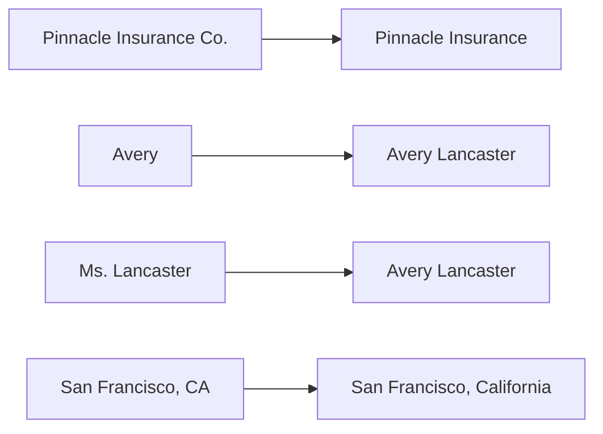

# 20 — Entity Deduplication and Linking: Deep Dive (P4-M4)

> **How this document was made.** Every output block was produced on 2026-09-21 by running the demo next to it against the code in this repository
> (`src/graph/dedup.py`). The demos that touch the database (C10 and the end-to-end script) write only names that start with `__demo_` and delete them
> in a `finally`; after everything ran, the real graph still had exactly 8 constraints and 0 nodes. Every exercise below with an "expected" answer was
> executed first, and the answer is what the code printed, not what I guessed. Nothing prints a password.
>
> **Three rules this document follows**
> 1. **Minimal demos.** Each demo holds one idea and nothing more (11 concept demos of 12 to 32 lines each, 240 lines in all, plus an 88-line end-to-end script and a 50-line failure lab), and
>    **every line has a `#` comment saying what it does.**
> 2. **Exact code.** For each concept you also get the code that was really built in P4-M4 as an **annotated copy**: each line keeps its real number and a
>    `#▸` comment above it says what it does. These blocks are generated from the source files and every annotated line is checked against the file
>    when the document is built, so the code shown is the code that runs.
> 3. **Interview tags.** Every concept title carries **[INTERVIEW: MUST KNOW]**, **[INTERVIEW: GOOD TO KNOW]** or **[INTERVIEW: RARELY ASKED]** for an
>    **AI-engineer interview**. That is my judgement of what such interviews emphasise, not a survey. Read it as a priority order for your time.
>
> **How each concept is laid out (so you DO things before you are told things)**
> `DO THIS FIRST` (predict, then run) → what it is, in plain words → what it is for a 14-year-old → why it is used *here* → what breaks if it is removed →
> the minimal demo and its real output → how it works inside → the exact project code → **five micro-exercises with hints** → how to check it is really
> working → what you should be able to explain afterwards → what to read.
>
> **Setup for every exercise.** Open a Python prompt in the project root (`.venv/Scripts/python -i`) and paste this once. The exercises assume it:
> ```python
> from src.graph.dedup import resolve_entities, deduplicate_entities, remap_edges, _words   # the P4-M4 functions (_words is private: we look inside)
> from src.graph.records import GraphNode, GraphEdge, NodeRef                             # the record types the functions work on
> emp = lambda n, **p: GraphNode("Employee", {"name": n}, p)                              # shorthand: an Employee node called n
> co = lambda n: GraphNode("Company", {"name": n})                                        # shorthand: a Company node called n
> names = lambda r: [n.key["name"] for n in r.nodes]                                       # shorthand: the names of a result's nodes
> ```
> Demos are in [`practice codes/phase 4/m4_entity_dedup_deep_dive/`](../practice%20codes/phase%204/m4_entity_dedup_deep_dive/). Run from the project root
> (Neo4j is needed only for C10 and the end-to-end script: `docker compose up -d neo4j`):
> ```bash
> .venv/Scripts/python "practice codes/phase 4/m4_entity_dedup_deep_dive/c1_why_dedup.py"
> ```

---

## 0. What this code does, in plain words, and the map of concepts

**The problem.** The documents about the company call the same thing by different names. A person is "Avery Lancaster" in the HR file, "Avery" in a
sentence and "Ms. Lancaster" in a letter. A client is "Pinnacle Insurance Co." in a contract title and "Pinnacle Insurance" in its body. A city is
"San Francisco, CA" in one place and "San Francisco, California" in another. If a computer treats each spelling as a different thing, it builds a graph in
which *one* person is *three* people, and a question like "which products does Avery work on?" only finds a third of the answer.

**What the code does.** `src/graph/dedup.py` takes a pile of nodes (one per spelling) and gives back **one node per real thing**, keeping every other
spelling as an **alias**. It also says where the merged-away spellings went (so relationships can be re-pointed) and **reports what it refused to guess**.
It is careful in a particular way: it would rather leave two duplicates than glue two different people together, because a wrong merge quietly mixes two
people's facts, while a missed merge only costs a missed connection.

**Analogy for the whole file.** A teacher gets an attendance sheet written by five different helpers: "Alice", "alice", "Alice Johnson", "A. Johnson",
"Ms. Johnson". The teacher must turn it into a class list with one line per student, without inventing anything. Rules like "ignore capital letters",
"ignore 'Ms.'" and "if only one Alice exists in the class, then 'Alice' is her" are safe. A rule like "if the name looks similar, it's probably the same
kid" is how you end up marking the wrong twin absent.

```
messy nodes ──► [C2 normalise] ──► [C3 per-kind rules] ──► [C4 scope: who may be compared]
                                                                  │
                          [C5 subset match: "exactly one"] ◄──────┘
                                     │  repeats until nothing changes  [C6 union-find + rounds]
                                     ▼
                          groups of spellings ──► [C7 canonical name + merged properties + aliases]
                                                            │
                     ┌──────────────────────────────────────┴──────────────────┐
                     ▼                                                          ▼
        merged nodes ─► Neo4j  [C10]                       alias map ─► [C8 remap edges]
                     ▲
        how we know it is right: [C1 the two ways to be wrong] · [C9 gold sets, precision/recall, properties, mutants]
```

### Interview map (for an AI engineer)

| # | Concept | Tag | Why an interviewer asks | A question you may get |
|---|---|---|---|---|
| C1 | Entity resolution and the two ways to be wrong | **[INTERVIEW: MUST KNOW]** | duplicated entities are the top data-quality failure of a knowledge graph | "How do you handle the same entity appearing under different names?" |
| C2 | Normalisation (case, punctuation, Unicode) | **[INTERVIEW: GOOD TO KNOW]** | text cleaning decides retrieval quality | "What do you do to text before you compare it?" |
| C3 | Per-kind rules (people, companies, places) | **[INTERVIEW: GOOD TO KNOW]** | shows you match rules to the data, not one trick for everything | "Would you use one similarity threshold for every entity type?" |
| C4 | Scope: what is never compared | **[INTERVIEW: GOOD TO KNOW]** | namesakes; cross-type false merges | "Two people share a name. How does your system avoid merging them?" |
| C5 | Subset matching with an "exactly one" rule | **[INTERVIEW: MUST KNOW]** | precision vs recall trade-off with a concrete mechanism | "How do you decide when to merge and when to leave things apart?" |
| C6 | Union-find and running until nothing changes | **[INTERVIEW: GOOD TO KNOW]** | a classic algorithm applied to a real problem; determinism | "How do you group items that are transitively related?" |
| C7 | Canonical name, survivorship, aliases | **[INTERVIEW: MUST KNOW]** | which value survives a merge is a design decision with consequences | "When two records disagree, which one wins and why?" |
| C8 | Alias map and re-pointing relationships | **[INTERVIEW: GOOD TO KNOW]** | merges break references unless you handle them | "What happens to relationships when you merge nodes?" |
| C9 | Measuring it: gold sets, precision and recall, properties, mutants | **[INTERVIEW: MUST KNOW]** | "how do you know it works?" is asked about every AI component | "How do you evaluate entity resolution?" |
| C10 | Writing the result: aliases in Neo4j and `SET +=` | **[INTERVIEW: GOOD TO KNOW]** | a real bug class: an "update" that overwrites instead of adding | "How would you let users search by an alias?" |

**If you have one hour:** C1, C5, C7, C9, then the end-to-end exercise at the end.

---


## C1 — Entity resolution and the two ways to be wrong  **[INTERVIEW: MUST KNOW]**

*Why an interviewer asks: duplicated entities are the most common data-quality failure of a knowledge graph, and "false merge vs false split" is the vocabulary that shows you have actually built one.*

### DO THIS FIRST (2 minutes: predict, then run)
1. Write down, on paper: for `["Alice", "alice", "Alice Johnson"]`, how many *different people* does a plain Python `set()` see? And how many would you like the code to see?
2. Write down: for `["Alex", "Alex Chen", "Alex Harper"]`, should "Alex" be joined to one of the others? If you say yes, which one, and how would the code know?
3. Now run `c1_why_dedup.py` (below) and compare with what you wrote.

### 1. Definition, in easy language
**Entity resolution** (also called *deduplication*, *record linkage* or *entity matching*) means: given many records that mention things, decide **which
records are about the same real-world thing**, keep **one** record per thing, and remember the other names as **aliases**.

There are exactly **two ways to be wrong**, and the whole design of this code follows from knowing them:

| Mistake | Name | What it looks like | What it costs in a graph |
|---|---|---|---|
| Joined two different things | **false merge** | "Alex" glued onto the wrong Alex | the two people's facts and neighbours are mixed; a multi-hop question walks from one person's documents into another's, and the answer is confidently wrong |
| Left one thing in two pieces | **false split** | "Bob Chen" and "Robert Chen" stay two nodes | a missed connection; the answer is incomplete, but nothing false was written |

A false merge is usually worse than a false split, because it is *silent* and *spreads*. That is why this code is conservative.

### Explained for a 14-year-old
Imagine your class group chat. Someone types "Sam said the test is on Friday". There are two Sams in your class. If your phone *guesses* which Sam and
files the message under the wrong one, then later you'll think the wrong person said it, and you'll tell other people. That is a **false merge**: two
different people squashed into one, and the mistake spreads because you trust it.

Now imagine the phone refuses to guess and puts the message under "Sam (which one?)". That is annoying, because now your contact list has an extra
entry, and you have to sort it out later. That is a **false split**. It costs you time, but nobody got the wrong information.

Entity resolution is the job of a very careful librarian: *"I will merge two cards only when I am sure. When I am not sure, I will leave both cards and
put a note on them."* The note is the part people forget: this code writes the doubt down (`Ambiguity`) so a human can look at it later.

### 2. Why it is used here (not generically)
- **The graph's identity is a name.** In P4-M2 each node's identity is its key: `Employee` is identified by `name`, `Company` by `name`, and so on, and the
  database enforces "one node per key". Two spellings are therefore *two nodes*. Without this step "Avery", "Avery Lancaster" and "Ms. Lancaster" would
  be three employees, and a question like "which products does Avery work on?" would find only the edges that happened to be written to one spelling.
- **P4-M2 already refused fuzzy matching on people** (decision D-2026-09-20-03): in this company's data "Sarah Chen" is one word away from "Alex Chen"
  and "Robert Chen". A "looks similar enough" rule would merge different people. So this step has to do the job with *rules that can be explained*.
- **The extractor will emit many spellings.** Documents mention the same thing many times, in different forms. Merging is what turns that noise into a
  graph you can walk.

**What would break or behave differently if it were removed or changed**
| Change | Effect |
|---|---|
| remove the step | one real thing = several nodes; graph paths split; recall of graph questions drops |
| use "first longer name that contains it" (demo below) | "Alex" silently glued to one Alex: a false merge that nothing reports |
| use fuzzy similarity with a threshold | merges Sarah Chen with Alex Chen (one word apart); also needs a library or a slow standard-library function |
| merge everything that shares a first name | precision collapses; 7 of the 32 employees share a first name with someone |

### 3. Minimal demo: three names, three treatments
`c1_why_dedup.py`
```python
# C1: why deduplicate -- the same names treated three ways. No database needed.
from src.graph.dedup import resolve_entities                                 # the P4-M4 function that decides who is who
from src.graph.records import GraphNode                                      # the record type it works on


def emp(name):                                                               # tiny helper: a name becomes an Employee node
    return GraphNode("Employee", {"name": name})                             # label + key, exactly as the store would hold it


names = ["Alice", "alice", "Alice Johnson"]                                  # the task's example: ONE person written three ways
print("exact match      :", sorted(set(names)))                              # a plain set keeps all three: three "people"
print("lower-case match :", sorted({n.lower() for n in names}))             # folding case helps a little: still two
result = resolve_entities([emp(n) for n in names])                           # the real function
for node in result.nodes:                                                    # one node comes back
    print("real function    :", node.key["name"], "| aliases =", node.properties["aliases"])  # its name and the spellings it absorbed

crowd = ["Alex", "Alex Chen", "Alex Harper"]                                 # a short name that fits TWO different people
first_match = next(m for m in crowd if m != "Alex" and "Alex" in m)          # naive rule: join the first longer name that contains it
print("first-match rule : 'Alex' joins", first_match, "<- silently guessed")  # a false merge: it may be the other Alex
crowd_result = resolve_entities([emp(n) for n in crowd])                     # the real function on the same three names
print("real function    :", [n.key["name"] for n in crowd_result.nodes])     # nothing merged
print("reported doubt   :", crowd_result.ambiguous[0].mention, "fits", crowd_result.ambiguous[0].candidates)  # the doubt is said out loud
```
Real output:
```
exact match      : ['Alice', 'Alice Johnson', 'alice']
lower-case match : ['alice', 'alice johnson']
real function    : Alice Johnson | aliases = ['Alice', 'alice']
first-match rule : 'Alex' joins Alex Chen <- silently guessed
real function    : ['Alex', 'Alex Chen', 'Alex Harper']
reported doubt   : Alex fits ('Alex Chen', 'Alex Harper')
```

**How to read it.** The plain set sees **three** people. Folding case gets it to **two**, and still misses that "Alice" is "Alice Johnson". The real
function returns **one** node and remembers "Alice" and "alice" as aliases. In the second half, the "first match" rule quietly joins "Alex" to Alex Chen
(a coin-flip presented as a fact), while the real function leaves all three and **says out loud** that "Alex" fits two people.

### 4. How it works inside (the whole pipeline in six moves)
1. **Scope**: put each node in a bucket (label, and for a `Contact` the organisation). Nothing is compared across buckets. (C4)
2. **Normalise**: turn every name into a list of lower-case words with the label's rules. (C2, C3)
3. **Exact groups**: names with the same words are one group.
4. **Subset match, repeated**: a shorter name joins a longer one only if exactly one longer name contains all its words. Repeat until nothing changes. (C5, C6)
5. **Canonical name, merged properties, aliases** for each group. (C7)
6. **Report**: the merged nodes, the alias map, the ambiguities and the conflicts. (C8)

### 5. The exact code: what comes back, and the two entry points (annotated copy of `src/graph/dedup.py`)
```python
#▸ L64-70: the doubt, written down: which mention, which candidates, and (for contacts) which organisation
64  class Ambiguity:
65      """A mention that fits several longer names, so it was left unmerged."""
66
67      label: str
68      mention: str
69      candidates: tuple[str, ...]
70      scope: str = ""
#▸ L74-81: two spellings disagreed about a property: what was kept and what was dropped
74  class Conflict:
75      """Two nodes for one entity disagreed on a property; `kept` is what the node now holds."""
76
77      label: str
78      name: str
79      property: str
80      kept: Any
81      dropped: Any
#▸ L111-115: everything one call returns: the merged nodes, the alias map, the doubts, the disagreements
111 class Resolution:
112     nodes: list[GraphNode]
113     alias_map: AliasMap
114     ambiguous: tuple[Ambiguity, ...]
115     conflicts: tuple[Conflict, ...]
#▸ L376-383: the full merge; returns a Resolution; known_names optionally pins authoritative spellings
376 def resolve_entities(
377     nodes: Sequence[GraphNode], *, known_names: Mapping[str, Iterable[str]] | None = None
378 ) -> Resolution:
379     """Merge nodes that are the same entity, and report what was merged, refused or in conflict.
380
381     `known_names` maps a label to names that are authoritative and pinned as canonical when
382     they match (for example the HR roster under "Employee").
383     """
#▸ L440-444: the specified function: only the merged nodes, as a thin wrapper
440 def deduplicate_entities(
441     nodes: Sequence[GraphNode], *, known_names: Mapping[str, Iterable[str]] | None = None
442 ) -> list[GraphNode]:
443     """The merged nodes, each with the other spellings of its entity under `aliases`."""
444     return resolve_entities(nodes, known_names=known_names).nodes
```

### 6. Five micro-exercises (do them at the Python prompt; write your prediction first)
**E1 (predict).** `names(resolve_entities([emp("Bob Smith"), emp("bob smith"), emp("BOB SMITH")]))`
*Hint:* three spellings differ only in capital letters. *You should see:* `['Bob Smith']`. Which spelling won, and why that one? (Look ahead to C7.)

**E2 (observe).** `r = resolve_entities([emp("Sam Lee", team="A"), emp("Sam Lee", team="B")])` then print `names(r)` and `r.conflicts`.
*Hint:* the two nodes have the *same* name, so they are the same entity by definition. *You should see:* one node `['Sam Lee']`, and a `Conflict` saying `team`
kept `'A'`, dropped `'B'`. The lesson: identical name means identical entity here; two real people called Sam Lee would be merged. (This is why P4-M2 puts
the organisation into a `Contact`'s key, C4.)

**E3 (find a false split).** `names(resolve_entities([emp("Bob Chen"), emp("Robert Chen")]))`
*You should see:* `['Bob Chen', 'Robert Chen']`, two nodes. *Question:* why can't the rules join them? *Hint:* "Bob" and "Robert" share no word. A nickname table
would fix it, but every fix has a price: which *false merge* could a nickname table create? (Think of a Bob who is not any Robert.)

**E4 (find a false merge).** `r = resolve_entities([emp("Robert Chen"), emp("Robert Chen Jr.")])`; print `names(r)` and `r.nodes[0].properties["aliases"]`.
*You should see:* one node `['Robert Chen Jr.']` with alias `['Robert Chen']`. This is a **known weakness** (a father and son merged). Which rule caused it? (Answer after C5:
the short name has exactly one longer name containing all its words.)

**E5 (predict the report).** Add a third Alex: `r = resolve_entities([emp(n) for n in ["Alex", "Alex Chen", "Alex Harper", "Alex Thomson"]])` and print `r.ambiguous[0].candidates`.
*You should see:* `('Alex Chen', 'Alex Harper', 'Alex Thomson')`. Change the number of Alexes and predict the tuple before you run.

### 7. Validate that it works (not just "no error")
The function has a promise you can test in five lines: **nothing is lost.** Every input node must still be reachable, as its own name or as an alias:
```python
r = resolve_entities([emp("Alice"), emp("Alice Johnson"), emp("Alex"), emp("Alex Chen")])   # any batch you like
kept = {n.key["name"] for n in r.nodes}                                                    # the names of the surviving nodes
for original in [emp("Alice"), emp("Alice Johnson"), emp("Alex"), emp("Alex Chen")]:        # every input node
    landed = r.alias_map.resolve(original.ref)                                              # where did it end up?
    print(original.key["name"], "->", landed.key["name"], landed.key["name"] in kept)       # the last column must always be True
```
*Healthy:* every line ends in `True`. *Unhealthy:* a `False` means a spelling vanished without a trace (that is data loss). Also read `r.ambiguous`: a healthy
run on real data has a *small, explainable* list (here, five names that several people share), not a long one and not an empty one where you know doubt exists.

### 8. After this you should be able to explain
- What entity resolution is, in one sentence, and its other names.
- The two errors, and why the second one is usually the cheaper mistake in a graph.
- Why "just fuzzy match the names" is a bad default here (name a pair from the data that breaks it).
- What the function returns besides the merged nodes, and why the *report* matters.

### 9. Interview: what a strong answer contains
- **"How do you deal with the same entity under different names?"** Strong: name the two errors and pick which to avoid (false merge), *then* the mechanism
  (normalise, block or scope, compare, cluster, choose a canonical form, keep aliases), and *how you would measure it* (C9). Weak: "I'd use embeddings/fuzzy matching" with no error analysis.
- **"Why not just use an LLM to decide?"** Non-deterministic, costs money per pair, hard to test; good as a *second stage* for the hard leftovers, not as the first.

### 10. Read
Christen, *Data Matching* (Springer, 2012), the chapters on the matching process and on evaluation; Elmagarmid, Ipeirotis & Verykios, "Duplicate Record Detection: A Survey"
(IEEE TKDE, 2007); the docs of the open-source Splink and dedupe libraries for how production systems structure the same steps.

---

## C2 — Normalisation: making different-looking text comparable  **[INTERVIEW: GOOD TO KNOW]**

*Why an interviewer asks: "what do you do to text before you compare it?" is a basic retrieval and data-cleaning question; Unicode is where confident answers fall over.*

### DO THIS FIRST (3 minutes)
1. Predict, without running: `_words("Ann-Marie O'Neil")`. How many words? Is the apostrophe a separator or is it deleted?
2. In the file system, "José" can be stored as 4 characters or as 5 (the accent as its own character). Predict: does Python think `"José" == "José"` if one of them is stored the other way?
3. Run `c2_normalise.py` below and compare.

### 1. Definition, in easy language
**Normalisation** means transforming text into a *standard form* so that things that mean the same thing become **equal**. Here it does four things to a name:
1. **Unicode normalisation (NFKC):** rewrite characters that *look* the same but are stored differently into one standard form. (An accented "é" can be one
   character or `e` plus a separate accent mark; a full-width "Ａ" is a different character from "A".)
2. **Case folding** (`casefold`): a stronger version of lower-casing that also handles special letters ("ß" becomes "ss").
3. **Delete apostrophes** (so "O'Brien" stays *one* word, "obrien").
4. **Split into words** on anything that is not a letter or digit (spaces, hyphens, underscores, dots).

### Explained for a 14-year-old
Two friends write the same name: one types "ANNA", one types "anna". To *you* they are obviously the same, but to a computer, `A` and `a` are as different as
`A` and `Z`. Normalising is like saying: "before we compare anything, everyone must write in the same handwriting." Lower-case everything, remove the fancy
decoration, cut the sentence into separate words.

The Unicode part is a sneaky one. On a computer, the letter "é" can be saved as **one** symbol, or as **two** (the letter "e" and then a tiny floating accent).
They look identical on your screen and are different in memory, like two Lego builds that look the same but are made from different bricks. Normalisation
rebuilds both of them from the same bricks so they finally compare equal.

### 2. Why it is used here (not generically)
Names come from many sources: a person typing, a PDF, a file name from macOS (which stores accents the second way). If the words are not normalised first,
"José García" typed by a person and "José García" from a file name would be two different people. The apostrophe rule exists for one specific reason: if
"O'Brien" were split into "o" and "brien", then "Michael Brien" would look like a shortened "Michael O'Brien" (a false merge, C1).

**What would break if removed**
| Removed | Effect (all tested) |
|---|---|
| `casefold` | "Alice" and "alice" are two people (the task's own example fails) |
| NFKC | the same accented name typed two ways becomes two people |
| apostrophe deletion | "Michael Brien" gets merged into "Michael O'Brien" |
| splitting on non-letters | "Alice_Smith" and "Alice Smith" become two people; punctuation stays glued to words |

### 3. Minimal demo
`c2_normalise.py`
```python
# C2: normalisation -- different-looking spellings become the same list of words. No database needed.
import re                                                                    # to show what a naive split would do
import unicodedata                                                           # the standard library's Unicode tools
from src.graph.dedup import _words                                           # the project's word splitter (private: imported to look inside)

quote = "Michael O" + chr(0x2019) + "Brien"                                  # a name written with a typographic apostrophe
for text in ["Alice  Smith", "ALICE SMITH", "alice_smith", "Alice-Smith", "Michael O'Brien", quote]:  # spacing, case, _, -, two apostrophes
    print(f"{text!r:<20} ->", _words(text))                                  # the words the matcher will compare

composed = "José"                                                            # e-acute as ONE character (what a person types)
decomposed = unicodedata.normalize("NFD", composed)                          # the same letter as 'e' + a combining accent (what some file systems store)
print("\nsame text?      ", composed == decomposed)                           # False: different characters underneath
print("lengths          ", len(composed), len(decomposed))                    # 4 vs 5: the accent is a separate character
print("with NFKC        ", _words(composed) == _words(decomposed))           # True: normalising first puts them back together
print("without NFKC     ", re.findall(r"[^\W_]+", decomposed.casefold()))    # the accent is dropped, leaving 'jose' (not 'josé')
```
Real output:
```
'Alice  Smith'       -> ['alice', 'smith']
'ALICE SMITH'        -> ['alice', 'smith']
'alice_smith'        -> ['alice', 'smith']
'Alice-Smith'        -> ['alice', 'smith']
"Michael O'Brien"    -> ['michael', 'obrien']
'Michael O’Brien'    -> ['michael', 'obrien']

same text?       False
lengths           4 5
with NFKC         True
without NFKC      ['jose']
```

**How to read it.** Six spellings collapse to just two word-lists. The two apostrophes (plain `'` and the curly `’`) give the **same** result. The last block is the
lesson: the two "José" strings are **not equal** (`False`), they have **different lengths** (4 and 5), and normalising first makes their words equal (`True`);
without it the accent disappears and you get `jose`, which is not `josé`.

### 4. How it works inside
`unicodedata.normalize("NFKC", text)` looks each character up in the Unicode tables: it *composes* an `e` followed by an accent into the single "é", and replaces
"compatibility" characters (full-width letters, ligatures like "fi") with their plain equivalents. `casefold()` maps every character to its case-independent
form. The regular expression `[^\W_]+` means "one or more characters that are letters or digits, and are **not** an underscore", and `re.findall` returns every such run: those runs are the words.

### 5. The exact code (annotated copy of `src/graph/dedup.py`)
```python
#▸ L121: turn a name into a list of words
121 def _words(text: str) -> list[str]:
#▸ L122: rebuild characters into one standard form, then fold case, in one line
122     folded = unicodedata.normalize("NFKC", text).casefold()
#▸ L123-124: why apostrophes are deleted, not split on: "o" would be thrown away and "Brien" would match
123     # Apostrophes are deleted, not split on: "O'Brien" must stay one word, or the "o" would
124     # be thrown away as an initial and "Brien" would match it.
#▸ L125: delete straight and curly apostrophes so O'Brien stays one word
125     folded = re.sub(r"['’]", "", folded)
#▸ L126: every run of letters or digits is a word; spaces, hyphens, dots and underscores are separators
126     return re.findall(r"[^\W_]+", folded)
```

### 6. Five micro-exercises
**E1 (predict).** `_words("  ALICE   smith ")`. *You should see:* `['alice', 'smith']`. Which two steps made that happen?

**E2 (predict, then check).** `_words("Ann-Marie O'Neil")`. *You should see:* `['ann', 'marie', 'oneil']`. The hyphen *splits*; the apostrophe *deletes*. *Hint:* re-read lines 123 to 126 and
decide which line does each.

**E3 (a surprise).** `_words("Straße")` and `"Straße".lower()`. *You should see:* `['strasse']` and `'straße'`. `casefold` turns "ß" into "ss"; `lower` does not. That is why the code uses `casefold`.

**E4 (see why NFKC matters).** Paste this and predict the last line first:
```python
import re                                                       # for the naive splitter below
fullwidth = chr(0xFF21) + "lice"                                # a FULL-WIDTH capital A followed by "lice": looks like "Alice"
naive = lambda t: re.findall(r"[^\W_]+", t.casefold())          # the same steps as _words, but WITHOUT the NFKC line
print(_words(fullwidth), ascii(naive(fullwidth)))               # compare the two answers
```
*You should see:* `['alice']` and `['ａlice']`. Without NFKC the first letter is still a full-width "a", so it does **not** equal a normal "a". (`ascii()` prints
the hidden character as an escape so your terminal does not choke on it.)

**E5 (a ligature).** `_words(chr(0xFB01) + "nance")` (that is "finance" with the two letters fused into one character). *You should see:* `['finance']`. Try this on a word from a PDF you have.
*Internally:* NFKC replaces the fused "fi" with the two letters "fi".

### 7. Validate that it works
Do not trust one example. Test a **property**: *two spellings that differ only in normalisation must give identical words.*
```python
import unicodedata                                                              # the same tool the code uses
word = "José García"                                                            # one composed spelling
variants = {word, unicodedata.normalize("NFD", word), word.upper(), word.lower(), "  " + word + "  "}  # four more spellings of it
print({tuple(_words(v)) for v in variants})                                     # healthy: exactly ONE distinct tuple
```
*Healthy:* a set with a single tuple. If you see two, some variant is being treated as a different person.

### 8. After this you should be able to explain
- The four steps and, for each, one input it fixes.
- Why `casefold` beats `lower`, and what NFKC does that neither does.
- Why apostrophes are deleted while hyphens split, and the false merge that the wrong choice would cause.

### 9. Interview: what a strong answer contains
- **"What preprocessing do you do before comparing strings?"** Strong: Unicode normalisation, case folding, whitespace and punctuation policy, and *a per-field decision*
  (names, IDs and codes need different treatment). Bonus: you say normalisation must be applied to *both* sides of every comparison.

### 10. Read
Python docs: `unicodedata.normalize`, `str.casefold`, `re` (the `\w` class). Unicode Standard Annex #15, "Unicode Normalization Forms" (unicode.org/reports/tr15/) for the NFC/NFD/NFKC/NFKD family.

---

## C3 — Per-kind rules: people, companies and places are different  **[INTERVIEW: GOOD TO KNOW]**

*Why an interviewer asks: it separates people who apply one similarity threshold to everything from people who look at what each entity type actually varies in.*

### DO THIS FIRST (3 minutes)
1. Predict which pairs the code will treat as the **same name** (True) and which as different (False): `Dr. Karen Phillips / Karen Phillips`, `Jordan K. Bishop / Jordan Bishop`,
   `GreenValley Insurance, LLC / GreenValley Insurance`, `The Acme / Acme`, `San Francisco, CA / San Francisco, California`, `Portland, OR / Portland, ME`.
2. Run `c3_label_rules.py` and score yourself. The surprising one is the initial: why would the code say `Jordan K. Bishop` and `Jordan Bishop` are **not** the same *name*? (It has a good reason; C5 uses it.)

### 1. Definition, in easy language
Each kind of entity gets its own **normaliser**, because each kind varies in a different way:

| Kind | What varies | What the rule does |
|---|---|---|
| Person (`Employee`, `Contact`) | titles ("Dr.", "Ms.", "Sir"), middle initials | drop *leading* titles; **keep** initials as words |
| Company | legal endings ("Inc.", "LLC", "Ltd", "Co."), a leading "The" | drop trailing legal endings (as many as there are) and a leading "The" |
| Place | state written as code or as full name | turn "CA" into "California" so both compare equal |
| Everything else (`Product`, `Contract`, `Document`, `Chunk`) | nothing: identified by a hash or a closed list | compare the identifier **exactly**, never fold case, never match part of it |

### Explained for a 14-year-old
Think of three sorting jobs. Sorting **people**, you ignore "Mr." and "Dr." because those are titles, not names. Sorting **companies**, you ignore "Inc." and "Ltd" because
every company has some legal ending and it isn't part of what people call it. Sorting **cities**, you know "CA" is short for "California". One rule cannot do
all three: if you dropped "Dr." from a company or "Inc." from a person, you would break something. So each kind gets its own tiny rulebook.

And some things must **never** be loosened at all. A product code like `about.md_1` and `about.md_10` are different pieces of the same document. If you started
"matching part of the name", `about.md_1` would swallow `about.md_10`. For those, the rule is: exactly equal or nothing.

### 2. Why it is used here (not generically)
These are the variants the P4-M2 audit actually found: legal names that differ from titles in 11 of 12 contracts, the city "San Francisco" written two ways, honorifics on
signatories ("Dr. Karen Phillips", "Sir Charles Pemberton"). The initial rule comes from a bug found while testing: the first version *dropped* initials, and that would have made
"J. Bishop" match "Alan Bishop" and "Jordan K. Bishop" the same as "Jordan L. Bishop".

**What would break if removed or changed**
| Change | Effect |
|---|---|
| use the person rule on companies | "Roadway Insurance Inc." and "Roadway Insurance" stay two companies |
| drop initials again | false merges: "J. Bishop" lands on "Alan Bishop" |
| loosen the rule for `Chunk` ids | `about.md_1` and `about.md_10` could merge: a corrupted graph |
| remove the state table | "San Francisco, CA" and "San Francisco, California" stay two places |

### 3. Minimal demo
`c3_label_rules.py`
```python
# C3: each kind of name has its own rules. No database needed.
from src.graph.dedup import _company_words, _location_display, _location_words, _person_words  # the four rule functions

checks = [                                                                   # (kind, rule, first spelling, second spelling)
    ("person: honorific", _person_words, "Dr. Karen Phillips", "Karen Phillips"),        # a title is not part of the name
    ("person: initial", _person_words, "Jordan K. Bishop", "Jordan Bishop"),             # an initial IS a word, so these differ
    ("company: suffix", _company_words, "GreenValley Insurance, LLC", "GreenValley Insurance"),  # a legal suffix is not the name
    ("company: 'The'", _company_words, "The Acme", "Acme"),                              # a leading "The" is not the name
    ("place: state code", _location_words, "San Francisco, CA", "San Francisco, California"),    # CA and California are one state
    ("place: two states", _location_words, "Portland, OR", "Portland, ME"),              # same city name, different states
]
for kind, rule, first, second in checks:                                     # run every rule on its pair
    a, b = rule(first), rule(second)                                         # the word tuples the matcher compares
    print(f"{kind:<18} same={a == b!s:<5} {a} vs {b}")                       # True only when the rule treats them as one name

print("\nplace display:", _location_display("san francisco, ca"))            # the constructed name a place is keyed on
```
Real output:
```
person: honorific  same=True  ('karen', 'phillips') vs ('karen', 'phillips')
person: initial    same=False ('jordan', 'k', 'bishop') vs ('jordan', 'bishop')
company: suffix    same=True  ('greenvalley', 'insurance') vs ('greenvalley', 'insurance')
company: 'The'     same=True  ('acme',) vs ('acme',)
place: state code  same=True  ('san', 'francisco', 'california') vs ('san', 'francisco', 'california')
place: two states  same=False ('portland', 'oregon') vs ('portland', 'maine')

place display: san francisco, California
```

**How to read it.** Each line prints the word-lists the two spellings became, and `same=True/False`. Honorific, suffix, "The" and state code all make the names equal. The initial makes them **differ** (a
good thing, see C5). Two states with the same city differ. The last line shows the *constructed* place name the code will key a node on: the city as written, the state spelled out.

### 4. How it works inside
Every rule is a small function that returns a tuple of words. They are bundled with three other settings into a `_Rules` record (how to display a name, whether the *fullest* or the *shortest* spelling should win,
and whether/how short a name may join a longer one). A dictionary maps each label to its `_Rules`, and anything not in the dictionary falls back to the exact rule. Looking up the rule for a label is one line: `_RULES.get(label, _EXACT)`.

### 5. The exact code (annotated copy of `src/graph/dedup.py`)
```python
#▸ L42: the titles that are not part of a person's name
42  _HONORIFICS = frozenset({"dr", "mr", "mrs", "ms", "miss", "prof", "sir", "dame"})
#▸ L43-46: the legal endings that are not part of a company's name
43  _LEGAL_SUFFIXES = frozenset(
44      {"inc", "incorporated", "llc", "llp", "lp", "ltd", "limited", "corp", "corporation"}
45      | {"co", "company", "plc"}
46  )
#▸ L129-137: words, minus leading titles; an initial stays a word (the comment says why)
129 def _person_words(name: str) -> tuple[str, ...]:
130     words = _words(name)
131     while words and words[0] in _HONORIFICS:
132         words = words[1:]
133     # An initial stays a word. Dropping it would read "J. Bishop" as "Bishop" and land it on
134     # Alan Bishop, and would make "Jordan K. Bishop" and "Jordan L. Bishop" one person. Kept,
135     # "Jordan Bishop" still joins "Jordan K. Bishop" through the subset rule, which refuses
136     # when both a K. and an L. exist.
137     return tuple(words)
#▸ L140-146: words, minus a leading "the" and any number of trailing legal endings (never emptying the name)
140 def _company_words(name: str) -> tuple[str, ...]:
141     words = _words(name)
142     if len(words) > 1 and words[0] == "the":
143         words = words[1:]
144     while len(words) > 1 and words[-1] in _LEGAL_SUFFIXES:
145         words = words[:-1]
146     return tuple(words)
#▸ L149-154: split "City, State" and turn a state code into the full name; None if it is not that shape
149 def _split_location(name: str) -> tuple[str, str] | None:
150     city, comma, state = name.partition(",")
151     state = state.strip()
152     if not comma or not city.strip() or not state or "," in state:
153         return None
154     return city.strip(), _STATES.get(state.rstrip(".").upper(), state)
#▸ L157-159: the words of the city plus the (expanded) state, or of the raw text if it is not City, State
157 def _location_words(name: str) -> tuple[str, ...]:
158     parts = _split_location(name)
159     return tuple(_words(f"{parts[0]} {parts[1]}" if parts else name))
#▸ L162-166: the DISPLAY form of a person's name: titles removed, original capitalisation kept
162 def _strip_honorifics(raw: str) -> str:
163     words = raw.split()
164     while len(words) > 1 and re.sub(r"\W", "", words[0]).casefold() in _HONORIFICS:
165         words = words[1:]
166     return " ".join(words)
#▸ L169-173: the DISPLAY form of a company's name: legal endings and the comma before them removed
169 def _strip_legal_suffix(raw: str) -> str:
170     words = raw.split()
171     while len(words) > 1 and re.sub(r"\W", "", words[-1]).casefold() in _LEGAL_SUFFIXES:
172         words = words[:-1]
173     return " ".join(words).rstrip(" ,.;")
#▸ L176-178: the DISPLAY form of a place: City, FullState
176 def _location_display(raw: str) -> str:
177     parts = _split_location(raw)
178     return f"{parts[0]}, {parts[1]}" if parts else " ".join(raw.split())
#▸ L182-186: one bundle of settings per kind of name
182 class _Rules:
183     words: Callable[[str], tuple[str, ...]]
184     display: Callable[[str], str]
185     prefer_more_words: bool
186     subset_min_words: int | None
#▸ L189-190: why a person may be matched on one word but a company may not
189 # A single word is enough to name a person ("Alice"), but not a company: "Life" or "Partners"
190 # alone would join whichever longer name happened to contain it.
#▸ L191-193: the three rulebooks: people, companies, places
191 _PEOPLE = _Rules(_person_words, _strip_honorifics, prefer_more_words=True, subset_min_words=1)
192 _COMPANY = _Rules(_company_words, _strip_legal_suffix, prefer_more_words=False, subset_min_words=2)
193 _PLACE = _Rules(_location_words, _location_display, prefer_more_words=False, subset_min_words=None)
#▸ L194-196: why identifiers are compared exactly
194 # Everything else is identified by a hash or a closed list (doc_id, chunk_id, product names), where
195 # folding case or matching parts of a value would merge different things.
196 _EXACT = _Rules(lambda s: (s,), lambda s: s, prefer_more_words=False, subset_min_words=None)
#▸ L197: which label uses which rulebook
197 _RULES = {"Employee": _PEOPLE, "Contact": _PEOPLE, "Company": _COMPANY, "Location": _PLACE}
```
*Two forms, on purpose.* **Words** (for comparing) are lower-case and stripped; **display** (for showing and for the node's key) keeps capital letters. Comparing on one and naming with the other is what lets
"ALICE SMITH" match "Alice Smith" and still produce the nicely written key "Alice Smith".

### 6. Five micro-exercises
**E1 (predict).** `from src.graph.dedup import _person_words` then `_person_words("Prof. Dr. Karen Phillips")`. *You should see:* `('karen', 'phillips')`: *both* titles go, because the code strips leading titles in a loop.

**E2 (predict).** `from src.graph.dedup import _company_words` then `_company_words("Acme Holdings Co., Ltd.")`. *You should see:* `('acme', 'holdings')`. Two endings ("Co" and "Ltd") were removed. *Hint:* the loop in `_company_words` removes endings from the end until none is left.

**E3 (predict).** `from src.graph.dedup import _location_words` then `_location_words("Denver, co") == _location_words("Denver, Colorado")`. *You should see:* `True`. The state code is matched in *upper case*, so "co" works, even though "co" is
also a legal suffix elsewhere: rules only apply to the kind they were written for.

**E4 (predict).** `_person_words("Mr. Sir Bob")`. *You should see:* `('bob',)`. What if the name is *only* a title? Try `_person_words("Dr.")` and then `resolve_entities([emp("Dr.")])` and read what happens (the code refuses to
produce an empty name).

**E5 (modify it, then undo it).** Teach the code a new title, without editing the file, by changing the set in memory:
```python
import src.graph.dedup as dd                                   # the module itself
print(dd._person_words("Rev. Tom Ng"))                         # before: ('rev', 'tom', 'ng')
dd._HONORIFICS = dd._HONORIFICS | {"rev"}                      # add "rev" to the set of titles, in memory only
print(dd._person_words("Rev. Tom Ng"))                         # after: ('tom', 'ng')
dd._HONORIFICS = dd._HONORIFICS - {"rev"}                      # undo it (or just restart Python)
```
*You should see:* `('rev', 'tom', 'ng')` then `('tom', 'ng')`. *Internally:* the function looks up `_HONORIFICS` **when it runs**, so replacing the module's variable changes the behaviour immediately.
This "change it in memory" trick is how you can experiment with any rule safely.

### 7. Validate that it works
For each rule, keep a tiny **table of pairs you know the answer to**, and let the computer check it:
```python
from src.graph.dedup import _person_words, _company_words, _location_words        # the three rules
must_equal = [(_person_words, "Ms. Ann Lee", "Ann Lee"), (_company_words, "Acme Inc.", "Acme"), (_location_words, "Austin, TX", "Austin, Texas")]   # same thing
must_differ = [(_person_words, "Jordan K. Bishop", "Jordan L. Bishop"), (_location_words, "Portland, OR", "Portland, ME")]                             # different things
print(all(rule(a) == rule(b) for rule, a, b in must_equal), all(rule(a) != rule(b) for rule, a, b in must_differ))   # healthy: True True
```
The *second* list matters as much as the first: it is your protection against false merges. The project's own tests do exactly this for all 51 state codes, typed a second time, independently of the table in the code.

### 8. After this you should be able to explain
- Why people, companies and places get different rules, with one example of each.
- The difference between the **words** a name is compared on and the **display** it is keyed on.
- Why identifiers (`Chunk`, `Contract`) use exact comparison, and the bug it prevents.
- Why an initial is a word, and the two false merges that keeping it prevents.

### 9. Interview: what a strong answer contains
- **"Would you use one similarity threshold for all entity types?"** Strong: no; different types vary differently (titles, legal forms, abbreviations); rules per type, exact match for identifiers, and evidence from the data for each rule.

### 10. Read
Python docs: `str.casefold`, `re`. For the idea of *standardisation* as a step before matching: Christen (2012), the data pre-processing chapter. For legal-entity name variants: any "company name matching" write-up from a KYC / sanctions-screening vendor shows how large the suffix list gets in production.

---


## C4 — Scope: what is never compared  **[INTERVIEW: GOOD TO KNOW]**

*Why an interviewer asks: namesakes (two different people with one name) are the standard trap in entity resolution, and "we only compare within a scope" is the standard defence.*

### DO THIS FIRST (2 minutes)
There are four "Robert Chen"s below. Predict how many nodes come out and which ones merge, then run `c4_scope.py`.
1. An `Employee` called Robert Chen (Insurellm's engineer).
2. A `Contact` Robert Chen at "Fortress Business Underwriters".
3. A `Contact` Robert Chen at "Fortress Business Underwriters, Inc." (same officer, the organisation written with a legal ending).
4. A `Contact` Robert Chen at "Insurellm".

### 1. Definition, in easy language
A **scope** is a fence: two nodes are only ever compared if they are inside the same fence. Here the fence is:
- the node's **label** (an `Employee` is never compared with a `Contact` or a `Company`), and
- for a `Contact`, also the **organisation** they belong to (after normalising it, so "Fortress Business Underwriters, Inc." and "Fortress Business Underwriters" are the same fence).

Anything outside a fence is *never evidence*: having the same name across fences proves nothing.

### Explained for a 14-year-old
Your school has a Robert in Year 9 and a Robert who is a teacher, and there's a Robert at the school across town. Nobody would say "they're the same person because they
have the same first name". You first ask *which group are we talking about?* Year 9 students only? Teachers only? The other school? The scope is the group you are allowed
to compare inside. Comparing across groups would be like deciding the teacher and the Year 9 student are one person.

### 2. Why it is used here (not generically)
This is the real situation found in P4-M2: a client's Chief Underwriting Officer called Robert Chen and Insurellm's engineer called Robert Chen are **different people**. P4-M2 already made `Contact`
a separate label with the organisation inside its key (`name + organization`) *so this mistake cannot happen in the database*. This step obeys the same rule: it never even compares them.

**What would break if removed or changed**
| Change | Effect |
|---|---|
| compare across labels | the engineer and the client's officer merge (false merge) |
| ignore the organisation for contacts | Robert Chen at Fortress and Robert Chen at Insurellm merge |
| compare the organisation *as written* (no normalising) | the same officer appears twice because of "Inc." (false split) |

### 3. Minimal demo
`c4_scope.py`
```python
# C4: scope -- what is never compared. No database needed.
from src.graph.dedup import resolve_entities                                 # the P4-M4 function
from src.graph.records import GraphNode                                      # the record type it works on

nodes = [                                                                    # four "Robert Chen"s, all from the real corpus's situation
    GraphNode("Employee", {"name": "Robert Chen"}),                          # Insurellm's engineer
    GraphNode("Contact", {"name": "Robert Chen", "organization": "Fortress Business Underwriters"}),        # a client's officer
    GraphNode("Contact", {"name": "Robert Chen", "organization": "Fortress Business Underwriters, Inc."}),  # the same officer, organisation written with a suffix
    GraphNode("Contact", {"name": "Robert Chen", "organization": "Insurellm"}),                            # a different organisation
]
for node in resolve_entities(nodes).nodes:                                   # the merged result, in a fixed order
    print(f"{node.label:<9}", dict(node.key))                                # label first: it decides who may be compared with whom
```
Real output:
```
Contact   {'name': 'Robert Chen', 'organization': 'Fortress Business Underwriters'}
Contact   {'name': 'Robert Chen', 'organization': 'Insurellm'}
Employee  {'name': 'Robert Chen'}
```

**How to read it.** Four inputs, **three** outputs. The two Fortress contacts merged (the organisation was normalised, and the node's key now says `Fortress Business Underwriters`, no "Inc."). The Insurellm contact and the
`Employee` stayed separate. The **label is printed first** because it is the first fence.

### 4. How it works inside
`resolve_entities` walks the input once and drops each node into a dictionary keyed by its **scope** (a small tuple: label, plus organisation words for a contact). Then it processes each bucket completely
separately. Nothing in the matching code even *sees* a node from another bucket: the fence is enforced by data structure, not by an `if` you might forget.

### 5. The exact code (annotated copy of `src/graph/dedup.py`)
```python
#▸ L230-233: the name to compare: the "name" key for people, companies and places; a joined key for identifier labels
230 def _name_of(node: GraphNode) -> str:
231     if node.label in _RULES:
232         return node.key["name"]
233     return "\x1f".join(node.key[part] for part in sorted(node.key))
#▸ L236-240: the fence: the label, plus the normalised organisation words for a Contact
236 def _scope(node: GraphNode) -> tuple[str, tuple[str, ...]]:
237     # Two people with one name at different organisations are different people (P4-M2).
238     if node.label == "Contact":
239         return node.label, _COMPANY.words(node.key["organization"])
240     return node.label, ()
#▸ L238: only contacts carry an organisation, so only they need the extra fence
238     if node.label == "Contact":
#▸ L239: the organisation is normalised with the COMPANY rules, so "Inc." does not split the fence
239         return node.label, _COMPANY.words(node.key["organization"])
#▸ L384: prepare the roster of authoritative names (C7)
384     known = {label: tuple(names) for label, names in (known_names or {}).items()}
#▸ L385: the buckets: scope -> the mentions inside it
385     scopes: dict[tuple[str, tuple[str, ...]], list[_Mention]] = {}
#▸ L386-390: walk every node once: pick its rulebook, normalise its name, and drop it into its scope's bucket
386     for node in nodes:
387         rules, name = _rules_for(node.label), _name_of(node)
388         # A name with no letters or digits would normalise to nothing and match every other one.
389         words = rules.words(name) or (name.casefold(),)
390         scopes.setdefault(_scope(node), []).append(_Mention(node, name, words))
#▸ L396-399: handle each bucket on its own, in a fixed order, with that label's rules
396     for scope in sorted(scopes):
397         label, _ = scope
398         rules = _rules_for(label)
399         groups, unresolved = _cluster(scopes[scope], rules)
```

### 6. Five micro-exercises
**E1 (predict).** `r = resolve_entities([emp("Sam Lee"), GraphNode("Contact", {"name": "Sam Lee", "organization": "Acme"})])`; print `sorted(n.label for n in r.nodes)`. *You should see:* `['Contact', 'Employee']`. Two nodes, because they live in different fences.

**E2 (predict).** Two contacts, one organisation written two ways:
`c = lambda n, o: GraphNode("Contact", {"name": n, "organization": o})` then `r = resolve_entities([c("Sam Lee", "Acme, Inc."), c("Sam Lee", "Acme")])`; print `[dict(n.key) for n in r.nodes]`.
*You should see:* `[{'name': 'Sam Lee', 'organization': 'Acme'}]`. One node, and its organisation is the constructed name without "Inc.".

**E3 (predict).** `r = resolve_entities([c("Chen", "Fortress"), c("Robert Chen", "Fortress"), c("Sarah Chen", "Insurellm")])`; print `sorted((n.key["name"], n.key["organization"]) for n in r.nodes)`.
*You should see:* `[('Robert Chen', 'Fortress'), ('Sarah Chen', 'Insurellm')]`. "Chen" joined Robert Chen because, *inside Fortress*, he is the only Chen. Sarah Chen at Insurellm was never a candidate. *Hint:* remove the fence in your head: how many Chens would there be?

**E4 (a label that is not a person).** `r = resolve_entities([GraphNode("Product", {"name": "Carllm"}), GraphNode("Product", {"name": "carllm"})])`; print `[n.key["name"] for n in r.nodes]`.
*You should see:* `['Carllm', 'carllm']`. Two nodes. Products come from a **closed list** of file names, so "carllm" is not a spelling of "Carllm": it is a mistake that should be *seen*, not hidden. (C3: identifiers are compared exactly.)

**E5 (look at the fence).** `import src.graph.dedup as dd` then `dd._scope(GraphNode("Contact", {"name": "Sam Lee", "organization": "Acme, Inc."}))`. *You should see:* `('Contact', ('acme',))`. That tuple is a bucket's name. Try a second contact with organization `"The Acme Corp"` and compare the tuples.

### 7. Validate that it works
Ask the question the fence exists to answer: **did any two nodes from different fences end up as one?** The alias map tells you what merged into what, so check every pair:
```python
r = resolve_entities([emp("Robert Chen"), GraphNode("Contact", {"name": "Robert Chen", "organization": "Fortress"})])   # two namesakes
crossed = [(a, b) for a, b in r.alias_map.pairs() if a.label != b.label]                                                # any merge across labels?
print(len(r.nodes), crossed)                                                                                           # healthy: 2 nodes, and []
```
*Healthy:* `2 []`. If `crossed` is ever non-empty, a fence has a hole.

### 8. After this you should be able to explain
- What a scope is, and which two things make up the scope here.
- Why the organisation is normalised *before* it is used as a fence.
- Why "same name" is not evidence across fences, in one sentence about the two Robert Chens.

### 9. Interview: what a strong answer contains
- **"Two people share a name. How does your system avoid merging them?"** Strong: identity is more than a name (add a second attribute: organisation, date of birth, email domain), *comparison is confined to a scope* (blocking is the general term), and ambiguity is reported rather than guessed. Bonus: "blocking" also exists for speed, and here it doubles as a safety fence.

### 10. Read
Papadakis, Skoutas, Thanos & Palpanas, "Blocking and Filtering Techniques for Entity Resolution: A Survey" (ACM Computing Surveys, 2020). Blocking is the general word for "only compare inside a bucket".

---

## C5 — Subset matching with an "exactly one" rule  **[INTERVIEW: MUST KNOW]**

*Why an interviewer asks: it is a concrete, explainable answer to the precision-versus-recall trade-off that every matching system faces.*

### DO THIS FIRST (3 minutes)
Write your answer to each, then run `c5_exactly_one.py`:
1. Names: `Alice`, `Alice Johnson`. Should "Alice" join "Alice Johnson"?
2. Names: `Alice`, `Alice Johnson`, `Alice Smith`. Should "Alice" join anyone?
3. Then think about the rule you used for 1 and 2 and write it in one sentence. (You have just invented this concept.)

### 1. Definition, in easy language
The **subset rule** says: a *shorter* name (all of its words are inside a *longer* name) **may join** the longer name. The **"exactly one" condition** adds the safety: it joins **only if there is exactly one** longer name that contains all its words.
- **0 candidates:** nothing to join; it stays as it is.
- **1 candidate:** join. The evidence is the shortness itself: no other name it could belong to exists.
- **2 or more candidates:** it is **ambiguous**. Do not guess. Leave it separate and **report it**.

### Explained for a 14-year-old
Your teacher says "Alice was late." If the class has one Alice, you know who it is: Alice Johnson. If the class has two Alices (Alice Johnson and Alice Smith), "Alice" could be either, and the honest answer is
"I don't know which". A careless person picks one and moves on; a careful person writes "Alice (which one?)" on the list. The "exactly one" rule is the careful person.

Notice this is the same principle as C1: choose the mistake that costs less. A wrong guess gives one Alice the other's lateness; an honest "which one?" costs a little tidying up.

### 2. Why it is used here (not generically)
The HR data really contains this situation. In a 32-person roster, 7 people share a first name with someone, and 5 of the first- or last-name words that documents use (Alex, Chen, Emily, Jordan, Thompson) each fit several people. A
rule that guessed would be silently wrong for those five; this rule merges 53 other short names correctly and stays out of those five.

The minimum length differs by kind (see C3's table): **one word is enough for a person** ("Alice"), but **a company needs two words**, because "Roadway" or "Life" alone would join whichever longer company name happened to contain it.

**What would break if removed or changed**
| Change | Effect |
|---|---|
| merge on the first match (no "exactly one") | "Alex" is glued to one Alex; nothing reports it |
| never use partial matching (drop the rule) | "Alice" and "Ms. Lancaster" stay separate: many false splits |
| let one-word company names join | "Roadway" merges into whichever Roadway-something is first |
| forget to *report* ambiguity | leftovers pile up with nobody knowing why |

### 3. Minimal demo
`c5_exactly_one.py`
```python
# C5: the subset rule -- a short name joins a longer one only if EXACTLY ONE longer name holds all its words. No database needed.
from src.graph.dedup import resolve_entities                                 # the real function, to compare with the idea
from src.graph.records import GraphNode                                      # the record type it works on


def supersets(short, names):                                                 # the idea in three lines, for teaching
    words = set(short.lower().split())                                       # the short name as a set of words
    return [n for n in names if words < set(n.lower().split())]              # every name whose words strictly contain them


for names in (["Alice", "Alice Johnson"], ["Alice", "Alice Johnson", "Alice Smith"]):  # one candidate, then two
    found = supersets("Alice", names)                                        # who could "Alice" be?
    verdict = "merge" if len(found) == 1 else "refuse (report it)" if found else "nothing to join"  # the rule's three outcomes
    print(f"{names!s:<50} candidates={found} -> {verdict}")                  # show the rule's decision

result = resolve_entities([GraphNode("Employee", {"name": n}) for n in ["Alice", "Alice Johnson", "Alice Smith"]])  # the real function, three names
print("real nodes  :", [n.key["name"] for n in result.nodes])               # all three survive
print("real report :", result.ambiguous)                                     # and the doubt is written down as an Ambiguity
```
Real output:
```
['Alice', 'Alice Johnson']                         candidates=['Alice Johnson'] -> merge
['Alice', 'Alice Johnson', 'Alice Smith']          candidates=['Alice Johnson', 'Alice Smith'] -> refuse (report it)
real nodes  : ['Alice', 'Alice Johnson', 'Alice Smith']
real report : (Ambiguity(label='Employee', mention='Alice', candidates=('Alice Johnson', 'Alice Smith'), scope=''),)
```

**How to read it.** The teaching function `supersets` counts candidates in three lines: one candidate merges, two are refused. The real function agrees, and, the important part, it
returns the doubt as data: an `Ambiguity` naming the mention ("Alice") and both candidates.

### 4. How it works inside
For each group, the code takes its **fullest form** (the group's longest word list) and turns it into a *set* of words. Then it asks: which *other* groups have a set that strictly contains mine
(`word_sets[i] < other`, Python's "proper subset")? It collects their positions. If the list has length 1, it records a merge; if longer, it records an ambiguity. Notice it does **not** merge yet: it
only *collects decisions*. Applying them is C6's job. Why not merge immediately? Because merging while looping would make the answer depend on the order of the loop.

### 5. The exact code (annotated copy of `src/graph/dedup.py`)
```python
#▸ L243-244: the longest word list in a group: the form used when matching the group
243 def _fullest(group: list[_Mention]) -> tuple[str, ...]:
244     return max((m.words for m in group), key=lambda words: (len(words), words))
#▸ L266-268: group the mentions of one scope; returns the groups and the ambiguities
266 def _cluster(
267     mentions: list[_Mention], rules: _Rules
268 ) -> tuple[list[list[_Mention]], list[tuple[int, list[int]]]]:
#▸ L269-271: first, names with identical words are one group (a dictionary keyed by the word tuple)
269     by_words: dict[tuple[str, ...], list[_Mention]] = {}
270     for mention in mentions:
271         by_words.setdefault(mention.words, []).append(mention)
#▸ L274: the starting groups
274     groups = list(by_words.values())
#▸ L276: each group's fullest form
276         forms = [_fullest(group) for group in groups]
#▸ L277: each form as a set, built once because the loop compares every pair
277         word_sets = [set(form) for form in forms]  # built once: the loop below compares every pair
#▸ L280-282: look at each group in turn; skip forms that are too short for this kind of name
280         for i, form in enumerate(forms):
281             if len(form) < rules.subset_min_words:
282                 continue
#▸ L283: every OTHER group whose word set strictly contains this one
283             supersets = [j for j, other in enumerate(word_sets) if j != i and word_sets[i] < other]
#▸ L284-287: why exactly one: a wrong merge fuses two people, a duplicate is only a missed link
284             # INTERVIEW: the two ways to be wrong. Merging on the first match would avoid
285             # leftovers but merge the wrong Alex (a false merge, which fuses two people's
286             # neighbourhoods in the graph); refusing leaves a duplicate (a false split), which is
287             # only a missed connection. Exactly one longer form is the evidence required.
#▸ L288-289: exactly one candidate: record "join group i to that group"
288             if len(supersets) == 1:
289                 merges.append((i, supersets[0]))
#▸ L290-291: several candidates: record the doubt, do not merge
290             elif supersets:
291                 ambiguous.append((i, supersets))
```

### 6. Five micro-exercises
**E1 (predict).** `r = resolve_entities([emp("Sam"), emp("Sam Lee")])`; print `names(r)` and `r.nodes[0].properties["aliases"]`. *You should see:* `['Sam Lee']` and `['Sam']`.

**E2 (predict, then read the report).** Add `emp("Sam Ng")` and print `names(r)` and `r.ambiguous[0].candidates`. *You should see:* `['Sam', 'Sam Lee', 'Sam Ng']` and `('Sam Lee', 'Sam Ng')`. Sam stays apart *and* the report names both candidates.

**E3 (predict).** `names(resolve_entities([emp("Sam"), emp("Sam Lee"), emp("Sam Lee")]))`. *You should see:* `['Sam Lee']`. Two identical "Sam Lee"s are **one group** (C6's first step: same words), so there is still exactly one candidate.
*Question:* what would happen if the code counted the two Sam Lees as two candidates? (Answer: "Sam" would be ambiguous. That is why identical spellings are grouped *first*.)

**E4 (a company).** `names(resolve_entities([co("Roadway"), co("Roadway Insurance")]))`. *You should see:* `['Roadway', 'Roadway Insurance']`. Not merged: one word is not enough for a company. Predict what a *person* would do: try `emp("Roadway")` and `emp("Roadway Insurance")`.

**E5 (a chain that needs thinking).** `r = resolve_entities([emp("Sam"), emp("Sam Lee Ng"), emp("Sam Ng")])`; print `names(r)`, `r.ambiguous`. *You should see:* `['Sam Lee Ng']` and `()`. All three merged. *Why:* in the first pass "Sam" fits **two** names (ambiguous for now) but
"Sam Ng" fits exactly **one** ("Sam Lee Ng") and joins it. In the *second* pass "Sam" fits only **one** group (the merged one), and joins. This is why C6 exists: **doubt can disappear once other merges have happened**.

### 7. Validate that it works
Use the **report as your test oracle**. For any batch, three things must be true, and you can check them in one line each:
```python
r = resolve_entities([emp("Alice"), emp("Alice Johnson"), emp("Alice Smith"), emp("Alex")])   # a mixed batch
for a in r.ambiguous:                                                                          # every doubt the code reported
    print(a.mention, "fits", a.candidates)                                                    # (1) each candidate list has 2 or more names
print([n.key["name"] for n in r.nodes])                                                        # (2) every ambiguous mention is still a node of its own
```
*Healthy:* every `candidates` tuple has **two or more** names (an ambiguity with one candidate would have been merged); every ambiguous mention is still present as a node; and `Alex`, which
fits nobody, is not in the report at all.

### 8. After this you should be able to explain
- The three outcomes (0, 1, 2 or more candidates) and what happens in each.
- Why "one word" is enough for a person and not for a company.
- Why the code *collects* decisions and does not merge immediately.
- What the `Ambiguity` object is for, and who reads it.

### 9. Interview: what a strong answer contains
- **"How do you decide when to merge and when to leave things apart?"** Strong: define the two errors, choose a **conservative default**, describe a rule with an explicit *evidence* requirement (unique candidate), and say the leftovers are **reported and reviewable**, not dropped.
  Bonus: you can name the weakness (unique *in this batch*, C1's E4 and the limitations in the notes) and the mitigation (an authoritative roster, `known_names`, C7).

### 10. Read
Fellegi & Sunter, "A Theory for Record Linkage" (JASA, 1969), the origin of the idea that you choose thresholds by weighing the cost of the two error types; Christen (2012) on classification and the "possible match" (clerical review) class, which is what `Ambiguity` is.

---

## C6 — Union-find, and repeating until nothing changes  **[INTERVIEW: GOOD TO KNOW]**

*Why an interviewer asks: grouping things that are related through chains is a classic algorithm question, and "is your function deterministic and safe to re-run?" is a classic pipeline question.*

### DO THIS FIRST (5 minutes)
1. Run `c6a_union_find.py`. Before you do, look at the line `joins = [(0, 1), (1, 2), (3, 4)]` and write the groups you expect. Then change it to `[(0, 1), (2, 3), (1, 3)]`, predict, and run again.
2. Run `c6b_rounds.py`. Before you do, predict: for `Alice`, `Alice Johnson`, `Alice Johnson Smith`, how many rounds will it take, and what does each round decide?

### 1. Definition, in easy language
Two ideas working together:

**Union-find** (also *disjoint-set*) is a tiny data structure for groups. It supports two operations: **union(a, b)** ("a and b are in the same group now") and **find(a)** ("who is the leader of a's group?"). Each item points to a *parent*;
following parents leads to the leader. Two items are in the same group exactly when they have the same leader. Its superpower: joining groups **in any order** gives the **same final groups**.

**Repeating until nothing changes** (a *fixpoint*): one pass of C5 may leave a name ambiguous that a *later* merge would settle. So the code runs C5, applies all its merges at once, and runs C5 **again** on the new groups; it stops when a round finds nothing to merge.

### Explained for a 14-year-old
Union-find is like team captains. At the start everyone is their own captain. When two people team up, one captain says "you're my captain now". To find out whether two people are on the same team, walk up to the captain and compare captains. It doesn't matter whether Sam joined Alex's team first
or Alex joined Sam's: after everything is done, the teams are the same.

The **rounds** are like a teacher asking the class the same question repeatedly: "Any two teams that should merge?" After the first merges, new answers become obvious that weren't before (like "Alice" only having one team to join now). She keeps asking until the whole class says "no, nothing more". Then you're done.
And here's the beautiful check: ask again on the finished list, and the answer must be "nothing to merge": doing it twice gives the same result as doing it once. Programmers call that being **idempotent**.

### 2. Why it is used here (not generically)
Merging decisions chain. "Alice" is ambiguous between "Alice Johnson" and "Alice Johnson Smith" until those two have merged with each other, and *then* "Alice" has one candidate. A single pass would leave "Alice" as a stray node **and, worse, report nothing about it**.
The re-run property matters for the pipeline: the graph ingestion job will run again and again; if a second run gave a different answer, every re-run would change the graph.

**What would break if removed or changed**
| Change | Effect |
|---|---|
| single pass instead of rounds | "Alice" stays separate, and nothing is reported (you can try this safely in E5) |
| merge immediately while looping | the result depends on the order of the input |
| no union-find (naive "copy this list into that list") | groups can be joined inconsistently when a name belongs to two chains |

### 3. Minimal demos
`c6a_union_find.py`
```python
# C6a: union-find -- joining groups and asking "which group is this?". No database needed.
def make(n):                                                                 # a fresh structure for n items
    return list(range(n))                                                    # parent[i] = i means "item i is its own group's leader"


def find(parent, i):                                                         # follow parents up to the group's leader
    while parent[i] != i:                                                    # a leader is its own parent
        parent[i] = parent[parent[i]]                                        # shortcut: point at the grandparent to make later finds faster
        i = parent[i]                                                        # climb one step
    return i                                                                 # the leader identifies the group


def union(parent, a, b):                                                     # join the group of a with the group of b
    parent[find(parent, a)] = find(parent, b)                                # make one leader point at the other


def groups(parent):                                                          # collect items by leader
    out = {}                                                                 # leader -> members
    for i in range(len(parent)):                                             # every item
        out.setdefault(find(parent, i), []).append(i)                        # file it under its leader
    return sorted(out.values())                                              # a canonical, comparable view


joins = [(0, 1), (1, 2), (3, 4)]                                             # "0 goes with 1", "1 goes with 2", "3 goes with 4"
forward, backward = make(5), make(5)                                         # two fresh structures
for a, b in joins:                                                           # apply the joins in the given order
    union(forward, a, b)                                                     # forward order
for a, b in reversed(joins):                                                 # apply the SAME joins in the opposite order
    union(backward, a, b)                                                    # backward order
print("forward groups :", groups(forward))                                   # [[0, 1, 2], [3, 4]]
print("backward groups:", groups(backward))                                  # identical: the order of joins does not matter
print("parent list    :", forward)                                           # the raw structure: leaders point at themselves
```
Real output:
```
forward groups : [[0, 1, 2], [3, 4]]
backward groups: [[0, 1, 2], [3, 4]]
parent list    : [2, 2, 2, 4, 4]
```

**How to read it.** The joins applied forwards and backwards give the **same groups**. The raw `parent` list shows leaders: items 0, 1 and 2 all lead to 2; items 3 and 4 lead to 4.

`c6b_rounds.py`
```python
# C6b: rounds until nothing changes (a fixpoint), watched from outside. No database needed.
import src.graph.dedup as dd                                                 # the module, so we can wrap one of its functions
from src.graph.records import GraphNode                                      # the record type it works on

real_merge, calls = dd._merge_groups, []                                     # keep the real function; remember each round


def spy(groups, merges):                                                     # a stand-in that reports, then calls the real one
    forms = [" ".join(dd._fullest(g)) for g in groups]                       # what each group looks like this round
    calls.append(merges)                                                     # count the round
    print(f"  round {len(calls)}: groups={forms}  merges(i->j)={merges}")   # show the decisions made this round
    return real_merge(groups, merges)                                        # do the real merge


dd._merge_groups = spy                                                       # plug the spy in (the loop looks the function up by name)
names = ["Alice", "Alice Johnson", "Alice Johnson Smith"]                    # a short name, a middle name, a full name
nodes = [GraphNode("Employee", {"name": n}) for n in names]                  # as Employee nodes
print("first run:")                                                          # heading
first = dd.deduplicate_entities(nodes)                                       # run once: watch the rounds
print("  result :", [(n.key["name"], n.properties["aliases"]) for n in first])  # one node, two aliases
calls.clear()                                                                # forget the first run's rounds
print("second run, on the first run's own output:")                          # heading
second = dd.deduplicate_entities(first)                                      # run again on what came out
print("  rounds that merged anything:", len(calls), "| same result:", second == first)  # 0 rounds, identical: idempotent
dd._merge_groups = real_merge                                                # put the real function back
```
Real output:
```
first run:
  round 1: groups=['alice', 'alice johnson', 'alice johnson smith']  merges(i->j)=[(1, 2)]
  round 2: groups=['alice', 'alice johnson smith']  merges(i->j)=[(0, 1)]
  result : [('Alice Johnson Smith', ['Alice', 'Alice Johnson'])]
second run, on the first run's own output:
  rounds that merged anything: 0 | same result: True
```

**How to read it.** The spy prints only rounds that **merged something**. Round 1: three groups; the middle name joins the full name, `(1, 2)` means "group 1 joins group 2". "Alice" is left because it fits two names right now. Round 2: after that merge there are only **two** groups, and "Alice" now has exactly one candidate: `(0, 1)`.
A third look finds nothing, so it stops. The second run, on the first run's own output, needs **zero** merging rounds and returns an identical result: idempotent.

### 4. How it works inside
`_merge_groups` receives the current groups and the list of decisions `(small, big)`. It makes a `parent` list (each group its own leader), then for each decision points the leader of `small` at the leader of `big`, using `find` to climb. Then it collects the members of every group under their leader. The `find` function
has a small trick, **path compression** (`parent[i] = parent[parent[i]]`): as it climbs, it shortcuts each step to the grandparent, so later climbs are almost instant. `_cluster` wraps this in `while ...:` and returns when a round produces no merges.

### 5. The exact code (annotated copy of `src/graph/dedup.py`)
```python
#▸ L247-249: apply one round of decisions to the groups
247 def _merge_groups(
248     groups: list[list[_Mention]], merges: list[tuple[int, int]]
249 ) -> list[list[_Mention]]:
#▸ L250: union-find: at the start every group is its own leader
250     parent = list(range(len(groups)))
#▸ L252-256: climb parents to the leader, shortcutting to the grandparent on the way
252     def find(i: int) -> int:
253         while parent[i] != i:
254             parent[i] = parent[parent[i]]
255             i = parent[i]
256         return i
#▸ L258-259: apply each decision: the leader of small now points at the leader of big
258     for small, big in merges:
259         parent[find(small)] = find(big)
#▸ L260-263: collect the members of each group under its leader and return the new list of groups
260     joined: dict[int, list[_Mention]] = {}
261     for index, group in enumerate(groups):
262         joined.setdefault(find(index), []).extend(group)
263     return list(joined.values())
#▸ L275: repeat only for kinds of name that use partial matching
275     while rules.subset_min_words is not None:
#▸ L292-293: a round with nothing to merge: stop and return the groups and the doubts still standing
292         if not merges:
293             return groups, ambiguous
#▸ L294-297: why the rounds repeat: order-independent, idempotent, and one pass would leave doubt that a merge resolves
294         # INTERVIEW: why a fixpoint. Decisions are made against the groups as they stood at the
295         # start of the round and the rounds repeat, so "Alice", "Alice Johnson" and "Alice Johnson
296         # Smith" end up the same whichever order they arrived in (order-independent), and a second
297         # run finds nothing left to merge (idempotent). One pass would leave "Alice" ambiguous.
#▸ L298: apply this round's decisions all at once, then loop
298         groups = _merge_groups(groups, merges)
```

### 6. Five micro-exercises
**E1 (paper).** Draw five dots numbered 0 to 4. Apply `union(0,1)`, `union(2,3)`, `union(1,3)` by drawing an arrow from the *first* item's leader to the *second* item's leader each time. Write the groups. *You should get:* `{0,1,2,3}` and `{4}`. Then run `c6a_union_find.py` with those joins to check.

**E2 (observe compression).** Add `print(parent)` at the top of `find` in a copy of `c6a_union_find.py`, and call `find(forward, 0)` twice. Watch the list change between calls. *Hint:* the shortcut line `parent[i] = parent[parent[i]]` rewrites entries as you climb.

**E3 (predict rounds).** Use the spy from `c6b_rounds.py` on `["Sam", "Sam Lee", "Sam Lee Ng", "Sam Lee Ng Ho"]` (four names, each a longer version of the last). Predict the number of rounds, then run.
*You should see:* **3** merging rounds. *Why:* each round can only resolve the ambiguity at the *bottom* of the chain: the longest pair merges first, then the next name has a single candidate, then the next. *Generalise:* how many rounds for a chain of ten names? (Nine.)

**E4 (idempotence).** `once = deduplicate_entities([emp(n) for n in ["Sam", "Sam Lee", "Sam Lee Ng"]])` then `deduplicate_entities(once) == once`. *You should see:* `True`. Now add the spy and confirm the second call makes **0** merging rounds.

**E5 (break it on purpose, safely).** Run a *mutant* of the module without touching the file: it reads the source, changes one line, and runs the changed copy:
```python
import pathlib, sys, types                                                     # tools to build a module from text
src = pathlib.Path("src/graph/dedup.py").read_text(encoding="utf-8")            # the real source
mutant = src.replace("groups = _merge_groups(groups, merges)", "return _merge_groups(groups, merges), []")   # ONE ROUND only, and forget the doubts
mod = types.ModuleType("dedup_one_round"); sys.modules["dedup_one_round"] = mod                              # an empty module, registered by name
exec(compile(mutant, "dedup_one_round", "exec"), mod.__dict__)                                              # run the changed source inside it
r = mod.resolve_entities([emp(n) for n in ["Alice", "Alice Johnson", "Alice Johnson Smith"]])                # the same input as the demo
print(names(r), [a.mention for a in r.ambiguous])                                                            # what does the broken copy return?
```
*You should see:* `['Alice', 'Alice Johnson Smith'] []`. "Alice" was **not** merged, and **nothing was reported**: the silent failure the fixpoint exists to prevent. The real file is untouched. Try other one-line changes (`==` to `>=` in the "exactly one" test) and predict what breaks.

### 7. Validate that it works
Two properties, in the same style as the tests:
```python
import random                                                                                    # to shuffle
batch = [emp(n) for n in ["Alice", "Alice Johnson", "Alice Johnson Smith", "Alex", "Alex Chen"]]  # any batch
base = deduplicate_entities(batch)                                                               # the reference answer
same = all(deduplicate_entities(random.Random(s).sample(batch, len(batch))) == base for s in range(200))   # 200 different input orders
print("order-independent:", same, "| idempotent:", deduplicate_entities(base) == base)          # healthy: True and True
```
*Healthy:* `True` and `True`. A `False` on the first means the answer depends on the order documents were read; on the second, that re-running your pipeline changes the graph.

### 8. After this you should be able to explain
- What union and find do, and why the order of unions does not matter.
- What a fixpoint is, and the exact scenario where one pass is not enough.
- What idempotent means and why an ingestion job needs it.
- Why decisions are *collected* in a round and *applied together*, not applied one by one.

### 9. Interview: what a strong answer contains
- **"How do you group items that are related transitively?"** Strong: union-find (or connected components), near-constant time per operation with path compression and union by rank, and *why it is order-independent*. Bonus: for entity resolution, warn about **chaining** (A~B and B~C also merges A with C) and say how you bound it (here: every merge needs a *unique* longer form).

### 10. Read
Cormen, Leiserson, Rivest & Stein, *Introduction to Algorithms*, the chapter on data structures for disjoint sets. Python docs: `list`, `dict.setdefault`. For idempotence in pipelines: any data-engineering text on "idempotent jobs" (the same run twice gives the same state).

---


## C7 — Canonical name, survivorship and aliases  **[INTERVIEW: MUST KNOW]**

*Why an interviewer asks: when two records disagree, which one wins? That is a design decision with consequences, and "survivorship" is the word that shows you know it is a decision.*

### DO THIS FIRST (3 minutes)
Predict each result, then run `c7_canonical_and_merge.py`:
1. Two spellings of one person: `Alice Johnson` says `job_title="CEO"`; `Alice` says `job_title="Chief"` and `city="Austin"`. What is the node's name? Which `job_title` survives? Does `city` survive?
2. Three spellings: `Robert`, `Robert Chen`, `Robert J. Chen`. Which name wins with no help? And if you tell the code "the HR roster spells him `Robert Chen`"?
3. A company seen **once**, as `Roadway Insurance Inc.`. Is the node's name `Roadway Insurance Inc.` or `Roadway Insurance`?

### 1. Definition, in easy language
When several spellings turn out to be one thing, you must produce **one node**. Three decisions have to be made, and each has a name:

| Decision | Name | The rule used here |
|---|---|---|
| Which name is the node's identity? | **canonical name** | people: the *fullest* spelling seen (most words), titles removed; companies: the *constructed* short name with no legal ending; places: `City, FullState`; **or** an authoritative spelling you supply (`known_names`) |
| When two spellings disagree about a *property*, which value stays? | **survivorship** | the canonical spelling's own value wins; gaps are filled from the others; lists are united; every disagreement is **reported** as a `Conflict` |
| What happens to the other spellings? | **aliases** | they become a sorted list on the node, `aliases`, never containing the canonical name |

### Explained for a 14-year-old
You're making the official class list. Five kids' handwriting gave you: "Alice", "alice", "Alice Johnson". The list needs *one* official line. You pick the most complete, properly written one ("Alice Johnson"), and you write the other spellings in a small
"also known as" box on that line, so if somebody asks for "Alice" you can still find her. That's canonical name plus aliases.

Now two helpers wrote different phone numbers for the same kid. Someone has to decide which number goes on the list. Here the rule is: *the number from the official line wins*, missing information gets filled in from the other lines, and whenever two numbers **disagree**, you put a sticky note on the list saying "these disagreed: kept
this one, dropped that one". That sticky note is a `Conflict`. It matters because nobody should ever lose information silently.

For companies there's a twist. "Roadway Insurance Inc." has a legal ending nobody uses in conversation. The code **builds** the name "Roadway Insurance" even if the version with "Inc." is the only one it saw. Why? Because tomorrow another batch of documents may only contain "Roadway Insurance", and both batches must
write the **same key** or the graph gets two companies.

### 2. Why it is used here (not generically)
- The graph's key is a single name (P4-M2). One node needs exactly one canonical spelling, and it must be **deterministic**: given the same spellings, always the same choice, whatever order they arrived in. So every tie is broken by the text itself.
- The `Company` key from P4-M2 is the *short name*, with the legal name as a property. So "longest spelling wins" would be wrong for companies: it would choose the legal form.
- A person's complete name cannot be *constructed* from nothing, so it depends on which spellings the batch contained. That is why `known_names` exists: the HR roster is authoritative, and a heuristic should never rename someone the roster spells otherwise.
- **A disclosed consequence:** 5 of the 32 contract titles end in "Inc." or "Co.", so their constructed key differs from the title as P4-M2 keyed them. Passing the titles as `known_names` pins them.

**What would break if removed or changed**
| Change | Effect |
|---|---|
| the shortest spelling wins for people | the node is called "Alice", not "Alice Johnson" |
| last writer wins for properties | the answer depends on input order; two runs disagree |
| conflicts not reported | the losing value vanishes silently |
| aliases not kept | "Ms. Lancaster" can never be traced back to the node |
| count words by blank-separated parts | "Anna Smith" beats "Anna Smith-Jones" (a real bug the random check found) |

### 3. Minimal demo
`c7_canonical_and_merge.py`
```python
# C7: choosing the canonical name and merging what each spelling knew. No database needed.
from src.graph.dedup import resolve_entities                                 # the P4-M4 function
from src.graph.records import GraphNode                                      # the record type it works on


def emp(name, **props):                                                      # an Employee node with optional properties
    return GraphNode("Employee", {"name": name}, props)                      # label + key + what this extraction knew


r = resolve_entities([emp("Alice Johnson", job_title="CEO"), emp("Alice", job_title="Chief", city="Austin")])  # two spellings, one disagreement
node = r.nodes[0]                                                            # the single merged node
print("name       :", node.key["name"])                                      # the fullest spelling won
print("properties :", dict(node.properties))                                 # CEO kept, city filled in, aliases added
print("conflict   :", r.conflicts[0])                                        # the losing 'Chief' is reported, not lost silently

people = [emp("Robert"), emp("Robert Chen"), emp("Robert J. Chen")]          # three spellings of one person
print("\nno roster :", resolve_entities(people).nodes[0].key["name"])        # the fullest spelling wins
pinned = resolve_entities(people, known_names={"Employee": ["Robert Chen"]})  # tell it the authoritative spelling
print("with roster:", pinned.nodes[0].key["name"], pinned.nodes[0].properties["aliases"])  # the roster spelling wins; the rest become aliases

company = resolve_entities([GraphNode("Company", {"name": "Roadway Insurance Inc."})]).nodes[0]  # ONE spelling, with a legal suffix
print("\ncompany key:", company.key["name"], "| alias:", company.properties["aliases"])  # the suffix is removed from the key even when alone
```
Real output:
```
name       : Alice Johnson
properties : {'job_title': 'CEO', 'city': 'Austin', 'aliases': ['Alice']}
conflict   : Conflict(label='Employee', name='Alice Johnson', property='job_title', kept='CEO', dropped='Chief')

no roster : Robert J. Chen
with roster: Robert Chen ['Robert', 'Robert J. Chen']

company key: Roadway Insurance | alias: ['Roadway Insurance Inc.']
```

**How to read it.** The node is named `Alice Johnson`; `job_title` is `CEO` (the canonical spelling's value wins), `city` was **filled in** from the other spelling, and `aliases` holds `Alice`. The `Conflict` object records that `Chief` was dropped. In the middle block, with no roster
the fullest name (`Robert J. Chen`) wins; **with** the roster the roster's `Robert Chen` wins and the others become aliases. The last line shows a company seen once: its key has **no** `Inc.`, and the original spelling is kept as an alias.

### 4. How it works inside
**Picking a name** (`_pick`): each spelling gets a *rank*, a tuple compared left to right: (1) how many **words** it has (more is better for people, fewer for companies), (2) does it *look properly written* (capitalised, not all capitals) and (3) the text itself as the final tie-breaker. The
smallest rank wins. Because (3) always decides ties, the winner never depends on input order.
**Known names** (`_canonical`): if any authoritative name normalises to the same words as one of the spellings actually seen, that name wins immediately. *Note the subtlety:* the roster only *pins*; it does not *link*. If the roster says "Robert Chen" but the batch only contains "Robert" and "Robert J. Chen", no spelling matches, so it changes nothing (E3).
**Merging properties** (`_merge_properties`): sort the spellings so the canonical one is first; then go through every property of every spelling: a new property is added; the same value again is fine; a *different* value is a **conflict**, except two lists of the same kind of thing, which are **united**.
**Aliases** (`_aliases`): the set of all raw spellings, plus any aliases they already carried, minus the canonical name, sorted.

### 5. The exact code (annotated copy of `src/graph/dedup.py`)
```python
#▸ L204-206: does the text look properly written: not ALL CAPS, every word starts with a capital
204 def _looks_proper(text: str) -> bool:
205     words = [w for w in text.replace(",", " ").split() if w[0].isalpha()]
206     return not text.isupper() and all(w[0].isupper() for w in words)
#▸ L209: choose the best spelling from a group
209 def _pick(displays: Iterable[str], rules: _Rules) -> str:
#▸ L210: every tie is broken by the text itself, so input order never matters
210     # Every tie is broken by the text itself, so the choice never depends on input order.
#▸ L211: the ranking tuple: number of words (direction depends on the kind of name), then properly-written, then the text
211     def rank(text: str) -> tuple[int, bool, str]:
#▸ L212-213: why words, not blank-separated parts: "Anna Smith-Jones" has three words and two parts
212         # Completeness is counted in the words the group was matched on, not in blank-separated
213         # parts: "Anna Smith-Jones" holds three words and "Anna Smith" two, yet both are two parts.
#▸ L214-215: count the words the group was matched on; return the tuple, where the smallest wins
214         count = len(rules.words(text))
215         return (-count if rules.prefer_more_words else count), not _looks_proper(text), text
#▸ L217: the lowest rank wins
217     return min(set(displays), key=rank)
#▸ L305: the node's name for one group
305 def _canonical(group: list[_Mention], rules: _Rules, known: Sequence[str]) -> str:
#▸ L306-310: a roster spelling that matches a spelling actually seen is never renamed by a heuristic
306     # A name from an authoritative list (the HR roster) is never renamed by a heuristic.
307     seen = {m.words for m in group}
308     for name in sorted(known):
309         if rules.words(name) in seen:
310             return name
#▸ L311-314: why company and place names are constructed: so any batch writes the same key
311     # INTERVIEW: a company or place name is CONSTRUCTED ("Roadway Insurance Inc." becomes
312     # "Roadway Insurance") rather than chosen among the spellings present, so two batches that
313     # saw a suffix, case or state-abbreviation variant still write the same key. A person's full
314     # name cannot be constructed, so it depends on which spellings the batch contained.
#▸ L315: otherwise choose among the DISPLAY forms of the group's spellings
315     return _pick((rules.display(m.name) for m in group), rules)
#▸ L327-331: read aliases already on a node; refuse anything that is not a list of strings
327 def _existing_aliases(node: GraphNode) -> list[str]:
328     value = node.properties.get(ALIASES, [])
329     if not isinstance(value, list) or not all(isinstance(alias, str) for alias in value):
330         raise ValueError(f"{node.label} {_name_of(node)!r}: {ALIASES!r} must be a list of strings")
331     return cast(list[str], value)
#▸ L334-336: merge what each spelling knew into one property dictionary
334 def _merge_properties(
335     group: list[_Mention], canonical: str, label: str
336 ) -> tuple[dict[str, Any], list[Conflict]]:
#▸ L337-339: the survivorship rule and why the order is fixed
337     # INTERVIEW: survivorship, the rule for which value a merged node keeps. The canonical
338     # spelling's own node goes first so its values win, and the rest follow in a fixed order so a
339     # conflict is always settled the same way, whatever order the extractions arrived in.
#▸ L340-343: the canonical spelling's own node first, then a fixed order
340     ordered = sorted(
341         group,
342         key=lambda m: (m.name != canonical, m.name, repr(sorted(m.node.properties.items()))),
343     )
#▸ L346-349: go through every property of every spelling; the aliases property is handled elsewhere
346     for mention in ordered:
347         for name, value in mention.node.properties.items():
348             if name == ALIASES:
349                 continue
#▸ L350-352: a new property, or the same value again: keep it
350             if name not in merged or merged[name] == value:
351                 merged.setdefault(name, value)
352                 continue
#▸ L353-359: two lists of one kind of thing are united, not treated as a disagreement
353             united = (
354                 merged[name] + [v for v in value if v not in merged[name]]
355                 if (isinstance(merged[name], list) and isinstance(value, list))
356                 else None
357             )
358             if united is not None and len({type(v) for v in united}) <= 1:
359                 merged[name] = united
#▸ L360-361: a real disagreement: keep the first value, and REPORT the dropped one
360             else:
361                 conflicts.append(Conflict(label, canonical, name, kept=merged[name], dropped=value))
#▸ L365-370: every raw spelling plus existing aliases, minus the canonical name, sorted
365 def _aliases(group: list[_Mention], canonical: str) -> list[str]:
366     names = {m.name for m in group}
367     for mention in group:
368         names.update(_existing_aliases(mention.node))
369     names.discard(canonical)
370     return sorted(names)
#▸ L407-409: attach the aliases to the merged node only if there are any
407             aliases = _aliases(group, name)
408             if aliases:
409                 properties[ALIASES] = aliases
```

### 6. Five micro-exercises
**E1 (predict).** `names(resolve_entities([emp("alice smith"), emp("ALICE SMITH"), emp("Alice Smith")]))`. *You should see:* `['Alice Smith']`. Three spellings with the same words: the tie is broken by "looks properly written". Now swap the properly written one for `"Alice smith"`, so the batch is `alice smith`, `ALICE SMITH`, `Alice smith`: none looks properly written any more. Predict the winner, then check. *You should see:* `['ALICE SMITH']`. When nothing looks properly written, plain text order decides, and capital letters sort before lower-case ones (a reminder that the rule is deterministic, not clever).

**E2 (predict; determinism is not correctness).** `r = resolve_entities([emp("Sam", age=30), emp("Sam", age=31)])`; print `r.nodes[0].properties["age"]` and `r.conflicts[0].dropped`. *You should see:* `30` and `31`. Now swap the two nodes in the list and run again. *You should see the same answer.* The code is **deterministic** (the smaller value in a fixed ordering wins), which is not the same as *right*: it is the reason the conflict is reported, so a human can decide.

**E3 (a subtle one: pins are not links).** `r = resolve_entities([emp("Robert"), emp("Robert J. Chen")], known_names={"Employee": ["Robert Chen"]})`; print `names(r)`. *You should see:* `['Robert J. Chen']`. The roster spelling `Robert Chen` matches **none** of the spellings in the batch, so nothing is pinned. Then add `emp("Robert Chen")` to the batch and run again: the roster spelling now wins.
*Question:* what would a "link mentions to a roster" step need that this code does not do? (It would *merge into* roster names even when they are absent from the batch. That is query-time entity linking, a later step.)

**E4 (lists).** `r = resolve_entities([emp("Sam", tags=["a"]), emp("Sam", tags=["b"])])`; print `list(r.nodes[0].properties["tags"])`. *You should see:* `['a', 'b']`. Two lists are united, not fought over. Now try `tags=["a"]` with `tags="b"` (a list against a single value) and predict: a conflict, or united? (A conflict: one is not a list.)

**E5 (aliases are sorted; capitals sort first).** `r = resolve_entities([emp("Alice Johnson"), emp("Alice"), emp("alice"), emp("ALICE")])`; print `r.nodes[0].properties["aliases"]`. *You should see:* `['ALICE', 'Alice', 'alice']`. Python sorts capital letters before lower-case ones. *Why sort at all?* Predict what would break if the list were in arrival order (the second run over shuffled input would give a different list).

### 7. Validate that it works
Three checks, each one a property you can state in a sentence:
```python
r = resolve_entities([emp("Alice Johnson", job_title="CEO"), emp("Alice", job_title="Chief", city="Austin"), emp("alice")])   # a small batch with a disagreement
node = r.nodes[0]                                                                                                            # the merged node
print("canonical not in its own aliases:", node.key["name"] not in node.properties["aliases"])                                # (1) must be True
print("aliases sorted:", node.properties["aliases"] == sorted(node.properties["aliases"]))                                    # (2) must be True
print("every disagreement reported:", [(c.property, c.kept, c.dropped) for c in r.conflicts])                                 # (3) [('job_title', 'CEO', 'Chief')]
```
*Healthy:* `True`, `True`, and exactly the disagreement you planted. If (3) is empty while you know two spellings disagreed, information is being lost silently. Also check the **direction** of a company: `co("Roadway Insurance Inc.")` alone must give a key with **no** legal ending.

### 8. After this you should be able to explain
- The three decisions (canonical name, survivorship, aliases) and the rule chosen for each.
- Why company names are constructed but a person's full name cannot be.
- Why every tie is broken by the text, and what would go wrong otherwise.
- What `known_names` does and, precisely, what it does *not* do.

### 9. Interview: what a strong answer contains
- **"When two records for the same entity disagree, which one wins?"** Strong: name the policy (source priority, most recent, most complete, most frequent, or *canonical record wins and gaps are filled*), say it must be **deterministic**, and that disagreements should be **reported**, not just resolved. Bonus: mention that survivorship is often *per field* (the most trusted source for each field).

### 10. Read
Christen (2012), the chapters on record classification and data fusion; the Splink documentation on "clustering and canonical records"; Python docs: `sorted` (key functions), `min` with `key=`.

---

## C8 — The alias map, and re-pointing relationships  **[INTERVIEW: GOOD TO KNOW]**

*Why an interviewer asks: merging nodes silently breaks every relationship that pointed at the removed ones. People who have merged real data know this; people who have only read about it forget.*

### DO THIS FIRST (3 minutes)
Alice and Alice Johnson are merged. Two relationships were written by the extractor: one for `Alice` and one for `Alice Johnson`, both pointing at the product `Carllm`. Predict: after merging, how many `WORKS_ON` edges should exist, and what would happen if you tried to write the *old* edge (from "Alice") to the database now?
Then run `c8_alias_map_remap.py`.

### 1. Definition, in easy language
An **alias map** is a lookup table: *"this spelling that I merged away now lives here"*. `remap_edges` uses it to **re-point** each relationship at the surviving node, and **collapses** relationships that became identical (two edges "Alice → Carllm" and "Alice Johnson → Carllm" are now the same edge, so one is enough).

### Explained for a 14-year-old
When you close one of your two email accounts, you set up **forwarding**: mail sent to the old address goes to the new one. The alias map is forwarding for the graph. Anyone who wrote to "Alice" gets delivered to "Alice Johnson". And if two friends both send you the *same* invite, one
from each address, you don't want it twice: those become one. That's collapsing.

Without forwarding, mail to the old address just bounces. In the graph that's an error: the database has no node called "Alice" any more, so an edge that mentions it cannot be written.

### 2. Why it is used here (not generically)
The extractor writes nodes and edges *separately*, each mentioning a name. Deduplication changes the names of nodes. The store (P4-M3) **refuses** an edge whose endpoint does not exist (`MissingEndpoint`), on purpose, so a typo can never invent a ghost node. Therefore an un-remapped edge fails **loudly** at load. Better loud than silent, but avoidable.

**What would break if removed or changed**
| Change | Effect |
|---|---|
| return only the nodes, no map | the caller cannot know where "Alice" went; edges fail at load |
| do not collapse identical edges | duplicates (harmless in the store, which merges them, but noisy and confusing) |
| ordering not fixed | the "first edge wins" rule becomes arbitrary |
| the map keyed by name only | two labels with the same name collide (C4's Robert Chens) |

### 3. Minimal demo
`c8_alias_map_remap.py`
```python
# C8: the alias map and edge remapping -- keeping relationships alive after a merge. No database needed.
from src.graph.dedup import remap_edges, resolve_entities                    # the alias map's user and the merge itself
from src.graph.records import GraphEdge, GraphNode, NodeRef                  # records for nodes, references and edges

nodes = [GraphNode("Employee", {"name": "Alice"}), GraphNode("Employee", {"name": "Alice Johnson"}),  # two spellings of one person
         GraphNode("Product", {"name": "Carllm"})]                           # and a product they work on
result = resolve_entities(nodes)                                             # merge them
for old, new in result.alias_map.pairs():                                    # every spelling that disappeared
    print("alias map :", old.key["name"], "->", new.key["name"])             # where it now points

carllm = NodeRef("Product", {"name": "Carllm"})                              # a reference to the product node
edges = [                                                                    # the extractor wrote one edge per spelling it saw
    GraphEdge("WORKS_ON", NodeRef("Employee", {"name": "Alice"}), carllm),   # written against the short spelling
    GraphEdge("WORKS_ON", NodeRef("Employee", {"name": "Alice Johnson"}), carllm),  # written against the full spelling
]
print("edges before:", len(edges), [e.source.key["name"] for e in edges])    # two edges, two different sources
fixed = remap_edges(edges, result.alias_map)                                 # point both at the canonical node
print("edges after :", len(fixed), [e.source.key["name"] for e in fixed])    # they became identical, so they collapsed into one
print("unknown ref :", result.alias_map.resolve(NodeRef("Employee", {"name": "Zed"})).key["name"])  # a reference nobody merged resolves to itself
```
Real output:
```
alias map : Alice -> Alice Johnson
edges before: 2 ['Alice', 'Alice Johnson']
edges after : 1 ['Alice Johnson']
unknown ref : Zed
```

**How to read it.** The map has one entry: `Alice -> Alice Johnson`. Two edges written against two different spellings become **one** after remapping, and a reference nobody merged (`Zed`) resolves to itself, so callers never need an `if`.

### 4. How it works inside
Every node reference has a **label** and a **key**. Neither can be used directly as a dictionary key (the key is a read-only view), so `_ref_id` turns them into a plain hashable tuple: the label plus the key's items **sorted**, so `{"name": .., "organization": ..}` and `{"organization": .., "name": ..}` are the same identity. `resolve_entities` fills the map: for every spelling whose key is **not** the canonical key, it records
"this reference → that node". `remap_edges` walks the edges: resolve both ends, build an *identity* (edge type, source, target), and if it has been seen, keep the **first** edge's values and only fill in what it lacks.

### 5. The exact code (annotated copy of `src/graph/dedup.py`)
```python
#▸ L84-86: a hashable identity for a node reference: the label plus its sorted key items
84  def _ref_id(ref: NodeRef) -> tuple[str, tuple[tuple[str, str], ...]]:
85      # NodeRef holds a read-only mapping and so cannot be a dict key; this is its hashable identity.
86      return ref.label, tuple(sorted(ref.key.items()))
#▸ L90-93: the lookup table: identity of a merged-away spelling -> the surviving node's reference
90  class AliasMap:
91      """Links each spelling that was merged away to the node that replaced it."""
92
93      by_id: Mapping[tuple[str, tuple[tuple[str, str], ...]], NodeRef]
#▸ L95-97: where does this reference live now? Unknown references resolve to themselves
95      def resolve(self, ref: NodeRef) -> NodeRef:
96          # A reference the merge never touched resolves to itself, so callers need no special case.
97          return self.by_id.get(_ref_id(ref), ref)
#▸ L99-100: how many spellings were merged away
99      def __len__(self) -> int:
100         return len(self.by_id)
#▸ L102-107: the map as readable (old, new) pairs, sorted so the order never depends on input order
102     def pairs(self) -> list[tuple[NodeRef, NodeRef]]:
103         # Sorted, so one merge lists its pairs in one order whatever order the nodes arrived in.
104         return [
105             (NodeRef(label, dict(key)), canonical)
106             for (label, key), canonical in sorted(self.by_id.items(), key=lambda item: item[0])
107         ]
#▸ L419-421: in the merge: for every spelling whose key is not the surviving key, record where it went
419             for mention in group:
420                 if dict(mention.node.key) != key:
421                     alias_ids[_ref_id(mention.node.ref)] = node.ref
#▸ L447-450: re-point edges at the surviving nodes
447 def remap_edges(edges: Sequence[GraphEdge], alias_map: AliasMap) -> list[GraphEdge]:
448     """Point edges at the canonical nodes, collapsing edges that became identical."""
449     remapped: dict[tuple[str, Any, Any], GraphEdge] = {}
450     for edge in edges:
#▸ L451: resolve both ends of the edge through the map
451         source, target = alias_map.resolve(edge.source), alias_map.resolve(edge.target)
#▸ L452: what makes two edges the same edge: the type and both ends
452         identity = (edge.type, _ref_id(source), _ref_id(target))
#▸ L453-456: the first time this edge is seen, keep it
453         earlier = remapped.get(identity)
454         if earlier is None:
455             remapped[identity] = GraphEdge(edge.type, source, target, dict(edge.properties))
456             continue
#▸ L457-458: why later duplicates are collapsed
457         # The store would keep only one such edge anyway; the first one's values win and the
458         # later one only fills what it lacks, as when nodes are merged.
#▸ L459-463: a later duplicate only adds properties the first one lacks; the first one's values win
459         extra = {k: v for k, v in edge.properties.items() if k not in earlier.properties}
460         if extra:
461             remapped[identity] = GraphEdge(
462                 edge.type, source, target, {**earlier.properties, **extra}
463             )
#▸ L464: the surviving edges in the order first seen
464     return list(remapped.values())
```

### 6. Five micro-exercises
**E1 (predict).** `r = resolve_entities([emp("Alice"), emp("Alice Johnson")])`; print `[(a.key["name"], b.key["name"]) for a, b in r.alias_map.pairs()]`. *You should see:* `[('Alice', 'Alice Johnson')]`.

**E2 (predict).** `r.alias_map.resolve(NodeRef("Employee", {"name": "Zed"})).key["name"]`. *You should see:* `'Zed'`. A reference nobody merged is returned unchanged.

**E3 (collapse).** Build two edges that will become identical and one exact duplicate, then count:
```python
loc = NodeRef("Location", {"name": "Austin, Texas"})                                        # a place both edges point at
e_short = GraphEdge("BASED_IN", NodeRef("Employee", {"name": "Alice"}), loc, {"remote": False})            # written for the short spelling
e_full = GraphEdge("BASED_IN", NodeRef("Employee", {"name": "Alice Johnson"}), loc, {"remote": True})      # written for the full spelling
print(len(remap_edges([e_short, e_full, e_full], r.alias_map)))                             # how many edges survive?
```
*You should see:* `1`. All three point from the same node to the same place once "Alice" is forwarded.

**E4 (first wins).** With the same `e_short` and `e_full`, print `[(e.source.key["name"], e.properties["remote"]) for e in remap_edges([e_short, e_full], r.alias_map)]`. *You should see:* `[('Alice Johnson', False)]`. The **first** edge's `remote=False` won, although the second said `True`. Swap the list order and predict the result. *Question:* is "first wins" *right*? (It is deterministic given the order of edges; the properties on remapped edges are worth a review when the extractor exists.)

**E5 (skip the remap and watch it fail, safely).** Make a scratch copy of the end-to-end script and change one word, so it writes the *un-remapped* edges:
```bash
sed 's/for e in fixed:/for e in edges:/' "practice codes/phase 4/m4_entity_dedup_deep_dive/watch_it_work.py" > /tmp/watch_unfixed.py
.venv/Scripts/python /tmp/watch_unfixed.py
```
(On Windows without `/tmp`, save the copy anywhere you like.) *You should see, at the end:* `MissingEndpoint: cannot write WORKS_ON: Employee(name='__demo_Avery') not found; upsert the node first`. The store refuses, naming the missing node, and the script's `finally` still cleans up. This is the failure the map exists to prevent.

### 7. Validate that it works
Two conservation checks:
```python
nodes = [emp("Alice"), emp("Alice Johnson"), emp("Zed")]                                    # a small batch
r = resolve_entities(nodes)                                                                 # merge it
survivors = {(n.label, tuple(sorted(n.key.items()))) for n in r.nodes}                     # identities of the surviving nodes
print(all((t.label, tuple(sorted(t.key.items()))) in survivors for t in (r.alias_map.resolve(n.ref) for n in nodes)))   # (1) every input maps to a survivor
print(len(nodes), "inputs ->", len(r.nodes), "nodes +", len(r.alias_map), "forwarded")      # (2) 3 inputs -> 2 nodes + 1 forwarded
```
*Healthy:* `True`, and inputs = nodes + forwarded whenever no name was *constructed* (a company built without its legal ending is one exception, because the new key matches no input). If (1) is ever `False`, an edge written against that input would dangle.

### 8. After this you should be able to explain
- What the alias map holds and why unknown references resolve to themselves.
- Why merging nodes breaks relationships, and how the store's strictness turns that into a loud error.
- Why identical edges are collapsed, and which one's properties win.
- Why a node reference needs a special hashable identity.

### 9. Interview: what a strong answer contains
- **"What happens to relationships when you merge two nodes?"** Strong: they must be **redirected** to the survivor; duplicates collapse; and you keep a **redirect table** so later writes (and old links) still resolve. Bonus: in Neo4j you can do it with APOC's `mergeNodes`, but doing it in your own code keeps the rules explicit and testable.

### 10. Read
Neo4j Cypher manual: `MERGE`; APOC documentation: `apoc.refactor.mergeNodes` (the database-side alternative). For the same idea in other systems: HTTP 301 redirects and Wikipedia's redirect pages are alias maps.

---

## C9 — Measuring it: gold sets, precision and recall, properties and mutants  **[INTERVIEW: MUST KNOW]**

*Why an interviewer asks: "how do you know it works?" is asked about every AI component. A team that only says "the tests pass" has not answered.*

### DO THIS FIRST (5 minutes: do it on paper)
There are four people. Truth: **A and B are the same person; C and D are the same person.** A buggy program produced these groups: **{A, B, C}** and **{D}**.
1. List every *pair* the program put together. List every pair that is *truly* together.
2. Count the pairs in both lists. Compute **precision** = (pairs that are in both) ÷ (pairs the program put together) and **recall** = (pairs that are in both) ÷ (pairs truly together).
3. Which number tells you the program was too eager, and which that it was too shy?
*(Answer: the program's pairs are AB, AC, BC. The true pairs are AB and CD. Only AB is in both. Precision = 1/3, recall = 1/2. Low precision means too many wrong joins; low recall means too many missed joins.)*
Then run `c9_measure_it.py`.

### 1. Definition, in easy language
Four different kinds of evidence, each catching what the others miss:

| Evidence | What it is | What it catches |
|---|---|---|
| **Gold set** | pairs of names you *know* the answer for: "must merge" and "must not merge" | wrong behaviour on the cases that matter (both error types) |
| **Precision and recall (pairwise)** | precision: of the pairs merged, how many were right? recall: of the pairs that should merge, how many did? | a *number* you can track as the rules change |
| **Properties** | statements that must hold for **every** input: order does not matter; running twice changes nothing; nothing is lost | whole classes of bug, on inputs you never thought of (random batches) |
| **Mutants** | deliberately break one line of the code and check a test fails | tests that pass without checking anything |

### Explained for a 14-year-old
Imagine you build a robot that sorts photos into "who is in the picture". How do you know it works? You don't just watch it run. First you make an **answer key**: 20 photos where you already know who is who. That's the *gold set*. Then you *grade* it two ways. **Precision**: when the robot says "these two photos are the same person", how often is it right? **Recall**: of all the pairs that really are the same person, how many did the robot find?
A lazy robot that never joins anything has perfect precision (it never said anything wrong!) and awful recall. A reckless robot that joins everything has perfect recall and awful precision. You need both numbers, and you want to know which one you're trading away.

Then you test the robot on *weird* stuff by making thousands of random photo piles: does shuffling the pile change its answer? (It shouldn't.) Finally, you **sabotage** the robot on purpose (unplug one wire) and check that your grading notices. If sabotage goes unnoticed, your grading is broken. That's mutation testing.

### 2. Why it is used here (not generically)
- A merge count says nothing about *correct* merges. Only pair-level scoring tells you whether the merges were right *and* whether any were missed.
- The gold pairs come from real corpus variants (P4-M2's audit), so they include the traps: three Alexes, two Robert Chens, one word between Sarah Chen and Alex Chen.
- The random check found a real bug that 101 hand-written tests and 100 mutants had all missed: `Anna Smith` beat `Anna Smith-Jones` because completeness was counted in blank-separated parts.
- **Honest limit:** the gold set came from the same audit that shaped the rules, so a score of 1.000 is optimistic. A held-out set of extractor output is the next honest test.

**What would break if removed**
| Removed | Effect |
|---|---|
| the "must not merge" list | a program that merges everything would score perfectly |
| the property tests | order-dependence or non-idempotence can go unseen for months |
| mutation testing | a test that asserts nothing looks like a passing test |

### 3. Minimal demo
`c9_measure_it.py`
```python
# C9: measuring a deduplicator -- pairs, precision, recall, and two properties. No database needed.
import itertools                                                             # to list every pair inside a group
import random                                                                # to shuffle the input
from src.graph.dedup import deduplicate_entities, resolve_entities          # the function under test
from src.graph.records import GraphNode                                      # the record type it works on

names = ["Avery", "Avery Lancaster", "Rachel", "Rachel Martinez", "Alex", "Alex Chen", "Alex Harper"]  # a tiny labelled set
truth = [{"Avery", "Avery Lancaster"}, {"Rachel", "Rachel Martinez"}, {"Alex Chen"}, {"Alex Harper"}, {"Alex"}]  # who really is who
nodes = [GraphNode("Employee", {"name": n}) for n in names]                  # the input


def pairs(groups):                                                           # every two names that share a group
    return {frozenset(p) for g in groups for p in itertools.combinations(sorted(g), 2)}  # unordered pairs


amap = resolve_entities(nodes).alias_map                                     # which spelling went where
by_node = {}                                                                 # canonical name -> the names merged into it
for n in names:                                                              # place every name under where it landed
    by_node.setdefault(amap.resolve(nodes[names.index(n)].ref).key["name"], set()).add(n)  # follow the alias map
predicted, actual = pairs(by_node.values()), pairs(truth)                    # pairs the code merged vs pairs that are truly one
hit = predicted & actual                                                     # merged AND truly one
print("precision:", len(hit) / len(predicted), "| recall:", len(hit) / len(actual))  # both 1.0 here

order_ok = all(                                                              # property 1: the input order must not matter
    deduplicate_entities(random.Random(s).sample(nodes, len(nodes))) == deduplicate_entities(nodes) for s in range(200))  # 200 shuffles
once = deduplicate_entities(nodes)                                           # property 2: running it again must change nothing
print("order-independent:", order_ok, "| idempotent:", deduplicate_entities(once) == once)  # both True
```
Real output:
```
precision: 1.0 | recall: 1.0
order-independent: True | idempotent: True
```

**How to read it.** The gold set says who really is who; the code's answers are turned into pairs; both scores are `1.0`. The last line runs two **properties**: 200 shuffled orders give the identical result, and running the function on its own output changes nothing.

### 4. How it works inside
*Pairwise scoring:* every group of size *n* contributes *n(n−1)/2* pairs. You collect the pairs the code joined, and the pairs the truth joined; the overlap is the number of correct joins. *Properties:* a property is a check you can run on any input. The project's random test generates 2,000 batches from small vocabularies, and for each checks order-independence,
idempotence, that no two output nodes share a key, that no name or property disappears, and that every reported ambiguity points at real nodes. *Mutants:* a script rewrote one line of `dedup.py` 101 different ways (each a plausible mistake, such as `==` becoming `>=`), ran the tests, and demanded a failure each time, then restored the file byte for byte.

### 5. The exact code (annotated copy of `tests/graph/test_dedup.py`)
```python
#▸ L676-682: everything that must be identical between two runs: nodes, alias pairs, ambiguities and conflicts
676 def snapshot(resolution):
677     return (
678         resolution.nodes,
679         resolution.alias_map.pairs(),
680         resolution.ambiguous,
681         resolution.conflicts,
682     )
#▸ L685-690: shuffle the input 30 ways; every answer must equal the first
685 def test_the_result_does_not_depend_on_the_order_of_the_input():
686     expected = snapshot(resolve_entities(MIXED))
687     for seed in range(30):
688         shuffled = list(MIXED)
689         random.Random(seed).shuffle(shuffled)
690         assert snapshot(resolve_entities(shuffled)) == expected
#▸ L693-695: idempotence: a second run must change nothing
693 def test_running_it_on_its_own_output_changes_nothing():
694     once = deduplicate_entities(MIXED)
695     assert deduplicate_entities(once) == once
#▸ L747-760: make a small random batch of people, companies, places and contacts from tiny vocabularies
747 def random_batch(rng: random.Random) -> list[GraphNode]:
748     batch = []
749     for _ in range(rng.randint(2, 8)):
750         properties = {"n": rng.choice([1, 2, 3])} if rng.random() < 0.3 else {}
751         kind = rng.choice(["Employee", "Employee", "Employee", "Company", "Location", "Contact"])
752         if kind == "Employee":
753             batch.append(emp(rng.choice(_PEOPLE), **properties))
754         elif kind == "Company":
755             batch.append(company(rng.choice(_ORGS), **properties))
756         elif kind == "Location":
757             batch.append(place(rng.choice(_CITIES)))
758         else:
759             batch.append(contact(rng.choice(_PEOPLE), rng.choice(_ORGS), **properties))
760     return batch
#▸ L763-784: 2,000 seeded batches: order-independent, idempotent, no shared keys, nothing lost, ambiguities real
763 def test_random_batches_are_order_independent_idempotent_lossless_and_never_share_a_key():
764     # A seeded sample rather than a library: the same 2000 batches run every time. The hyphenated
765     # surname above was found this way, in one batch of twenty thousand.
766     rng = random.Random(2026)
767     for _ in range(2000):
768         batch = random_batch(rng)
769         first = resolve_entities(batch)
770         shuffled = list(batch)
771         rng.shuffle(shuffled)
772         assert snapshot(resolve_entities(shuffled)) == snapshot(first), batch
773         assert deduplicate_entities(first.nodes) == first.nodes, batch
774         by_key = {(n.label, tuple(sorted(n.key.items()))): n for n in first.nodes}
775         assert len(by_key) == len(first.nodes), batch
776         for node in batch:
777             landed = first.alias_map.resolve(node.ref)
778             merged = by_key[(landed.label, tuple(sorted(landed.key.items())))]
779             # Nothing is lost: the name survives as the key or an alias, and so does every property.
780             assert node.key["name"] in {merged.key["name"], *aliases_of(merged)}, node
781             assert set(node.properties) <= set(merged.properties), node
782         for ambiguity in first.ambiguous:
783             names = {n.key["name"] for n in first.nodes if n.label == ambiguity.label}
784             assert {ambiguity.mention, *ambiguity.candidates} <= names, ambiguity
#▸ L790-803: run the code over the names in a gold set and return the pairs it got wrong: false splits and false merges
790 def judge(label: str, others: list[str], must_merge, must_not_merge):
791     """Deduplicate every name in the pairs plus `others` (bystanders that decide whether a short
792     form is ambiguous) and return the labelled pairs it got wrong: (false splits, false merges)."""
793     names = sorted({*others, *(name for pair in [*must_merge, *must_not_merge] for name in pair)})
794     alias_map = resolve_entities([GraphNode(label, {"name": n}) for n in names]).alias_map
795
796     def same(a: str, b: str) -> bool:
797         return alias_map.resolve(NodeRef(label, {"name": a})) == alias_map.resolve(
798             NodeRef(label, {"name": b})
799         )
800
801     false_splits = [pair for pair in must_merge if not same(*pair)]
802     false_merges = [pair for pair in must_not_merge if same(*pair)]
803     return false_splits, false_merges
#▸ L806-826: the people gold set: must-merge pairs and must-not-merge pairs, including the three Alexes and the two Chens
806 def test_gold_people():
807     must_merge = [
808         ("Avery", "Avery Lancaster"),
809         ("Lancaster", "Avery Lancaster"),
810         ("Ms. Lancaster", "Avery Lancaster"),
811         ("Rachel", "Rachel Martinez"),
812         ("Jordan Bishop", "Jordan K. Bishop"),
813         ("Dr. Karen Phillips", "Karen Phillips"),
814     ]
815     must_not_merge = [
816         ("Alex", "Alex Chen"),  # three Alexes
817         ("Alex Chen", "Alex Harper"),
818         ("Sarah Chen", "Alex Chen"),  # one word apart: the case fuzzy matching gets wrong
819         ("Jennifer Rodriguez", "Carlos Rodriguez"),
820         ("Jennifer Rodriguez", "Jennifer Adams"),
821         ("Emily", "Emily Carter"),  # two Emilys
822         ("Michael Torres", "Michael O'Brien"),
823         ("Robert Chen", "Alex Chen"),
824     ]
825     roster = ["Alex Harper", "Alex Thomson", "Emily Tran", "Sarah Chen", "Jennifer Adams"]
826     assert judge("Employee", roster, must_merge, must_not_merge) == ([], [])
```

### 6. Five micro-exercises
**E1 (paper).** Do the "DO THIS FIRST" arithmetic if you have not. Then invent a program that never joins anything: precision? recall? (*Precision is undefined, since it made no claims; recall is 0.*)

**E2 (modify c9: make a worse algorithm and see the number move).** Add this to `c9_measure_it.py` and score it the same way:
```python
def first_match_groups(names):                                                 # the naive rule: join each short name to the first longer name containing it
    groups = {}                                                                # target name -> the set of names joined to it
    for n in names:                                                            # every name in turn
        target = next((m for m in names if m != n and n in m), n)             # the first other name that contains this text, or itself
        groups.setdefault(target, set()).add(n)                                # file it under that target
    return list(groups.values())                                               # the groups
```
Score `first_match_groups(names)` with the same `pairs(...)` and `truth`. *You should see:* **3** pairs joined, **2** true, **2** correct: precision **0.667**, recall **1.0**. The naive rule glued "Alex" to "Alex Chen": a false merge, visible only because the gold set contains a *must-not-merge* case.

**E3 (add a false split and watch recall move).** Add `"Bob Chen"` and `"Robert Chen"` to `names` and `{"Bob Chen", "Robert Chen"}` to `truth`, then score the real function. *You should see:* precision **1.0**, recall **0.667** (2 of 3 true pairs found). The rules cannot know Bob is Robert. Precision stayed perfect because it never made a wrong claim. This is the trade-off in numbers.

**E4 (run the random check with seeds of your own).** The project's generator can be imported. Try 3,000 seeds of your own:
```python
import random                                                                   # for seeded randomness
from tests.graph.test_dedup import random_batch                                  # the project's batch generator
from src.graph.dedup import deduplicate_entities                                 # the function under test
bad = sum(deduplicate_entities(once) != once for once in (deduplicate_entities(random_batch(random.Random(s))) for s in range(3000)))   # non-idempotent runs
print("idempotence failures:", bad)                                              # healthy: 0
```
*You should see:* `0`. Now think about what *you* would check next (a property you can state in one sentence), and add it.

**E5 (sabotage it, without touching the file).** Use the mutant trick from C6, this time changing the "exactly one" test:
```python
import pathlib, sys, types                                                       # tools to build a module from text
src = pathlib.Path("src/graph/dedup.py").read_text(encoding="utf-8")            # the real source
mutant = src.replace("if len(supersets) == 1:", "if len(supersets) >= 1:")       # "merge even when several fit"
mod = types.ModuleType("dedup_first_match"); sys.modules["dedup_first_match"] = mod
exec(compile(mutant, "dedup_first_match", "exec"), mod.__dict__)
for order in (["Alex", "Alex Chen", "Alex Harper"], ["Alex", "Alex Harper", "Alex Chen"]):     # the same names in two orders
    r = mod.resolve_entities([emp(n) for n in order])
    print([(n.key["name"], n.properties.get("aliases")) for n in r.nodes], "reported:", len(r.ambiguous))
```
*You should see:* `[('Alex Chen', ['Alex']), ('Alex Harper', None)] reported: 0` and then `[('Alex Chen', None), ('Alex Harper', ['Alex'])] reported: 0`. The broken copy joins "Alex" to a **different** person depending on the order, and reports nothing. Which of the four kinds of evidence would catch this? (All four: the gold set, the order property, the ambiguity report and the mutant itself.)

### 7. Validate that it works: run the project's own evidence
```bash
.venv/Scripts/python -m pytest tests/graph/test_dedup.py -q -m "not live"                                   # 107 tests
.venv/Scripts/python -m pytest tests/graph/test_dedup.py -q -m "not live" --cov=src.graph.dedup --cov-report=term-missing   # which lines ran?
```
Real output:
```
........................................................................ [ 67%]
...................................                                      [100%]
=============================== tests coverage ================================
_______________ coverage: platform win32, python 3.11.3-final-0 _______________

Name                 Stmts   Miss  Cover   Missing
--------------------------------------------------
src\graph\dedup.py     240      0   100%
--------------------------------------------------
TOTAL                  240      0   100%
107 passed, 2 deselected in 7.49s
```

*Healthy:* all pass, and **Miss = 0** in the coverage table. **Warning:** 100% coverage means every line *ran*, not that every line is *checked*: a test that calls a function and asserts nothing gives full coverage. That is exactly the gap the mutation check closed: the first run left 8 of 100 mutants alive, five of them real test gaps. Read the notes file (`notes/step-4.4-entity-deduplication.md`) for how each survivor was handled.

### 8. After this you should be able to explain
- Precision and recall for *pairs*, with the four-people example, and which error each one detects.
- Why a gold set needs *must-not-merge* pairs.
- What a property is, and give three for this code.
- What a mutant is and why coverage alone cannot replace it.
- Why the gold set's perfect score is optimistic.

### 9. Interview: what a strong answer contains
- **"How do you evaluate entity resolution?"** Strong: a labelled sample (or synthetic gold set), *pairwise* precision and recall (and maybe cluster metrics), a review queue for the uncertain class, tracking the numbers across rule changes, plus *invariants* (determinism, idempotence) and a held-out set to avoid grading yourself on the data that shaped the rules.
  Weak: "I looked at some examples" or "accuracy".

### 10. Read
Christen (2012), the evaluation chapter (why accuracy is misleading when almost all pairs are non-matches); Manning, Raghavan & Schütze, *Introduction to Information Retrieval*, the evaluation chapter (precision and recall defined); scikit-learn docs, "Precision, recall and F-measures"; Hypothesis docs (hypothesis.readthedocs.io) for property-based testing as a library; Jia & Harman, "An Analysis and Survey of the Development of Mutation Testing" (IEEE TSE, 2011).

---


## C10 — Writing the result: `aliases` in Neo4j and what `SET +=` really does  **[INTERVIEW: GOOD TO KNOW]**

*Why an interviewer asks: "how would users search by an alias?" tests whether you understand that a list stored on a node is data, not an index, and that an "update" can silently overwrite instead of add.*

### DO THIS FIRST (5 minutes; needs Neo4j: `docker compose up -d neo4j`)
Before running `c10_aliases_in_neo4j.py`, write down what `aliases` holds:
1. after **batch 1** (which knows the alias "Alice") is written;
2. after **batch 2** (which knows a *different* alias, "Ms. Johnson") is written to the *same* node;
3. and, harder: what if batch 2 had known **no** alias at all?

### 1. Definition, in easy language
`SET n += $props` means *"for each property named in this map, write it onto the node, replacing whatever value that property had; leave every other property alone."* Two consequences that matter here:
- A **list is one value**. Writing `aliases: ["Ms. Johnson"]` does not add to the stored list; it **replaces the entire list**.
- A property you **do not mention** is untouched. A batch with no aliases leaves the stored aliases exactly as they were.

And a second, separate fact: `aliases` is a list *inside* a node. The lookup we measured for "is this value somewhere in that list" is a label scan plus a filter (C10 E2), so looking a node up **by alias** means scanning nodes and checking their lists.

### Explained for a 14-year-old
On the classroom whiteboard, each student has a box: "Also known as: ...". Batch 1 writes "Alice" in Alice Johnson's box. Batch 2 comes along, knows another nickname, and instead of *adding* it to the box, it **wipes the box and writes its own list**. The first nickname is gone. That's `+=` with a list.
(But if batch 2 doesn't touch the box at all, the box stays as it was.)

Finding a student by nickname is the second problem: the whiteboard is sorted by *official name*. To find who is called "Avery" you'd have to read **every box**. Computers call that a scan, and it gets slow as the class grows. A proper solution is a second whiteboard sorted by nickname: an index (or separate `Alias` nodes with an index).

### 2. Why it is used here (not generically)
This is the price of decision D-2026-09-21-08: aliases are a list property, so the graph model, its 8 constraints and the record types stayed unchanged. The alternative (an `Alias` node per spelling with an `ALIAS_OF` edge) would have changed P4-M2. The consequences are real, and now measured:
- an alias list **cannot accumulate across batches** through the store as written; the ingestion job must *read, union, write*;
- the store's lookup (`search_related`) matches an **exact `name`**, so searching for "Avery" finds nothing today: entity linking at query time is a later step.

**What would break or change if it were changed**
| Change | Effect |
|---|---|
| use `SET n = $props` | the node's key is wiped too (P4-M3 C4) |
| write aliases as `Alias` nodes with an index | lookups become index seeks; but the model, records and constraints change |
| union in the ingestion job (the demo's fix) | aliases accumulate; costs one read per node |

### 3. Minimal demo (needs Neo4j)
`c10_aliases_in_neo4j.py`
```python
# C10: what happens to `aliases` when the result is written to Neo4j (needs: docker compose up -d neo4j).
import uuid                                                                  # a unique prefix, so the cleanup is exact
from src.graph.dedup import deduplicate_entities                             # the merge
from src.graph.records import GraphNode                                      # the record type
from src.graph.setup import build_driver                                     # the project's driver factory
from src.retrieval.graph_store import GraphStore                             # the P4-M3 store

prefix = f"__demo_{uuid.uuid4().hex[:6]}_"                                   # every demo name starts with this


def merged(*names):                                                          # dedupe clean names, then prefix the RESULT (prefixes would break matching)
    node = deduplicate_entities([GraphNode("Employee", {"name": n}) for n in names])[0]  # one merged node
    return GraphNode("Employee", {"name": prefix + node.key["name"]}, dict(node.properties))  # same node, prefixed key


def stored(session):                                                         # read the aliases now in the database
    return session.run("MATCH (e:Employee) WHERE e.name STARTS WITH $p RETURN e.aliases AS a", p=prefix).single()["a"]  # one row


with build_driver() as driver, driver.session() as session:                  # open a connection and a session
    try:                                                                     # cleanup below must always run
        store = GraphStore(driver)                                           # the store (checks the constraints exist)
        store.upsert_node(merged("Alice", "Alice Johnson"))                  # batch 1 knows the alias "Alice"
        print("after batch 1:", stored(session))                             # ['Alice']
        store.upsert_node(merged("Ms. Johnson", "Alice Johnson"))            # batch 2 knows a DIFFERENT alias, "Ms. Johnson"
        print("after batch 2:", stored(session), "<- 'Alice' is gone: SET += replaced the list")  # ['Ms. Johnson']
        old = set(stored(session))                                           # the fix: read what is stored first...
        new = merged("Alice", "Alice Johnson")                               # ...merge in the alias a third batch knows...
        store.upsert_node(GraphNode("Employee", dict(new.key), {"aliases": sorted(old | set(new.properties["aliases"]))}))  # ...write the union
        print("after union  :", stored(session))                             # ['Alice', 'Ms. Johnson']: nothing lost
    finally:                                                                 # always clean up
        session.run("MATCH (e:Employee) WHERE e.name STARTS WITH $p DETACH DELETE e", p=prefix).consume()  # remove only this demo's node
```
Real output:
```
after batch 1: ['Alice']
after batch 2: ['Ms. Johnson'] <- 'Alice' is gone: SET += replaced the list
after union  : ['Alice', 'Ms. Johnson']
```

**How to read it.** After batch 1 the list is `['Alice']`. After batch 2 it is `['Ms. Johnson']`: **'Alice' is gone.** The fix in the last step reads what is stored, unions it with the new aliases, and writes the union: `['Alice', 'Ms. Johnson']`. The demo prefixes names with `__demo_` *after* merging (a prefix would otherwise change what counts as a word) and its `finally` deletes only what it made.

### 4. How it works inside
`GraphStore.upsert_node` runs one query in a managed write transaction: `MERGE (n:Label {key...}) SET n += $props`. `MERGE` finds or creates the node by its full key (the uniqueness constraint makes that safe and fast). `SET +=` is then applied with the properties map from the record, which includes `aliases` when the merged node has any. The database never sees "append": it only sees "set property `aliases` to this list".

### 5. The exact code (annotated copies)
```python
#▸ L115: write one node
115     def upsert_node(self, node: GraphNode) -> None:
#▸ L117-121: why MERGE finds-or-creates, and why += adds properties while = would wipe the key
117         # INTERVIEW: MERGE on the full key finds-or-creates exactly one node, and the
118         # uniqueness constraint from P4-M2 makes that atomic and index-backed.
119         # `SET n += map` adds and overwrites the properties given but never deletes
120         # the others, so two documents that each know part of an entity can both
121         # write it. `SET n = map` would wipe the key itself.
#▸ L122: MERGE on the full key, then SET n += $props
122         query = f"MERGE (n:{node.label} {{{_key_pattern(node.label, 'k')}}}) SET n += $props"
#▸ L123: the key values and the properties (including aliases) travel as parameters
123         params = {**_key_params(node.key, "k"), "props": dict(node.properties)}
#▸ L124: run it as a managed write transaction
124         self._write(lambda tx: tx.run(query, params).consume())
```
```python
#▸ L1009-1011: the test that PINS the limit: a later upsert replaces the alias list instead of adding to it
1009 def test_live_a_later_upsert_replaces_the_alias_list_instead_of_adding_to_it(live_store):
1010     # Pins a known limit rather than a wish: SET += replaces a list property wholesale, so a
1011     # second batch that knows a different spelling erases the first batch's aliases.
#▸ L1012: the live store, the driver and a unique prefix for this test's data
1012     store, driver, p = live_store
#▸ L1013-1014: two batches write the same node with different aliases
1013     store.upsert_node(emp(f"{p}Alice Johnson", aliases=[f"{p}Alice"]))
1014     store.upsert_node(emp(f"{p}Alice Johnson", aliases=[f"{p}AJ"]))
#▸ L1016-1020: read the aliases back and assert only the second batch's alias is there
1016     with driver.session() as session:
1017         aliases = session.run(
1018             "MATCH (e:Employee {name: $n}) RETURN e.aliases AS a", n=f"{p}Alice Johnson"
1019         ).single()["a"]
1020     assert aliases == [f"{p}AJ"]
```
```python
#▸ L407-409: where the merged node gets its aliases property (only when there are any)
407             aliases = _aliases(group, name)
408             if aliases:
409                 properties[ALIASES] = aliases
```

### 6. Five micro-exercises
**E1 (predict, then run).** Run `c10_aliases_in_neo4j.py` and compare with your three-line prediction. *You should see:* `['Alice']`, then `['Ms. Johnson']`, then `['Alice', 'Ms. Johnson']`.

**E2 (predict the cost).** Run the end-to-end script with `--keep` (later in this document), open Neo4j Browser at `http://localhost:7474`, and run
`PROFILE MATCH (e:Employee) WHERE 'Avery' IN e.aliases RETURN e.name`. *You should see* an operator chain that ends in **`NodeByLabelScan`** then **`Filter`**: every `Employee` node is visited and its list checked. Predict what the chain would look like for `MATCH (e:Employee {name: 'Avery Lancaster'})` (an index seek on the unique key), and check.

**E3 (write the fix yourself).** In a copy of `c10_aliases_in_neo4j.py`, turn the last three lines of the `try` block into a function `upsert_keeping_aliases(store, session, node)` that reads the stored aliases, unions them with `node.properties["aliases"]`, and writes the result. *Hint:* the stored list comes from the same query as `stored(session)`, and `sorted(set(a) | set(b))` is the union. *You should get* the same `['Alice', 'Ms. Johnson']`. Then think: what if two jobs run at the same moment? (Read-then-write is not atomic: a real system needs a single Cypher statement or a lock.)

**E4 (predict: what if a batch has no aliases?).** In a scratch script (use a `__demo_` prefix and a `finally` that deletes it), upsert a node with `{"aliases": ["S"]}`, then upsert the *same key* with `{"city": "Austin"}` and read `aliases`. *You should see:* `['S']`. `+=` only overwrites the properties it names.

**E5 (design the alternative, in a scratch label).** In Neo4j Browser, with throwaway labels so nothing real is touched:
```cypher
CREATE INDEX demo_alias_name FOR (a:DemoAlias) ON (a.name);
CREATE (:DemoAlias {name: 'Avery'})-[:ALIAS_OF]->(:DemoPerson {name: 'Avery Lancaster'});
PROFILE MATCH (a:DemoAlias {name: 'Avery'})-[:ALIAS_OF]->(p:DemoPerson) RETURN p.name;
```
*You should see* `NodeIndexSeek` at the bottom of the plan, then `Expand(All)`: an index lookup, not a scan. Clean up when done:
```cypher
MATCH (n) WHERE n:DemoAlias OR n:DemoPerson DETACH DELETE n;
DROP INDEX demo_alias_name;
```
*Question:* what would using `Alias` nodes change in the P4-M2 model, the records and the store? (A new label, a new relationship type, a key for `Alias` nodes, and a rewrite of `search_related` to follow `ALIAS_OF`.)

### 7. Validate that it works
Look at the **database**, not the Python object. After a load, three queries tell you what is really there:
```cypher
MATCH (n) WHERE n.name STARTS WITH '__demo_' RETURN labels(n)[0] AS label, count(n) AS nodes ORDER BY label;   // how many nodes per label
MATCH (e:Employee) WHERE e.name STARTS WITH '__demo_' RETURN e.name, e.aliases;                              // are the aliases what you expect?
MATCH (n) WHERE n.name STARTS WITH '__demo_' AND NOT (n)--() RETURN n.name;                                    // nodes with no relationship at all
```
*Healthy:* node counts equal the merged-node count from Python (not the input count); aliases are sorted lists that do not contain the node's own name; the third query returns only nodes you *expect* to be unconnected. A different count means a spelling was written as its own node; an unexpectedly empty `aliases` means a later upsert replaced it.

### 8. After this you should be able to explain
- What `SET +=` does with a list, and with a property it is not given.
- Why an alias list cannot accumulate through the store, and the read-union-write fix and its race.
- Why "search by alias" is a scan today and what an index-based design looks like.
- Which earlier decision (D-2026-09-21-08) this is the price of.

### 9. Interview: what a strong answer contains
- **"How would you let users search by an alias?"** Strong: model aliases so they can be **indexed**: separate alias nodes (or a text/full-text index on a normalised field), normalise the query the same way as the stored names (C2), return all candidates rather than guessing when it is ambiguous (C5), and keep provenance so the answer can be traced. Weak: "loop over the aliases".

### 10. Read
Neo4j Cypher manual: `SET` (replacing and mutating properties with `+=`), indexes (range, text, full-text), and `PROFILE`/`EXPLAIN`; Neo4j Python driver manual: transactions and `execute_write`.

---

## 3. Teach me to validate that it is really working (not just "no errors")

"No exception" tells you almost nothing here: a deduplicator that merges *everything* or *nothing* never crashes. You need evidence about what it **decided**. Here are the techniques, from cheapest to strongest. Every command below was run.

### 3.1 See the decisions (the round spy)
Wrap `_merge_groups` (C6's demo) and **print each round**. What you learn: how many rounds, which groups joined, and that a second run makes **zero** rounds. *Healthy:* a short list of rounds ending in "nothing to merge". *Unhealthy:* many rounds on a small input (a chain that shouldn't exist), or rounds on the second run (not idempotent).

### 3.2 Read what the function tells you it *did not* do
`Resolution` has four fields; look at all of them, not only `nodes`:
| Field | What to read | Healthy | Unhealthy |
|---|---|---|---|
| `nodes` | how many came out vs went in | fewer than in, for a messy batch | same as in (nothing merged) or one node (everything merged) |
| `alias_map` | what went where | every entry is a spelling you recognise as the same thing | any pair you would not merge in real life |
| `ambiguous` | the doubts | short, explainable (five shared names in the HR roster) | long; or empty when you know several people share a first name |
| `conflicts` | disagreeing properties | each one is a real disagreement | many identical-looking conflicts (an extractor bug producing two values) |

### 3.3 State properties and test them on many inputs
The three the project checks: **order-independence, idempotence, nothing lost** (C6, C1 and C9 have the snippets). The project runs 2,000 seeded random batches; you can run your own with `from tests.graph.test_dedup import random_batch` (C9 E4). A property test finds bugs by asking a *question about all inputs* instead of checking a few examples: that is how `Anna Smith` vs `Anna Smith-Jones` was found.

### 3.4 Score it against a gold set
Precision and recall on pairs you *know* (C9). *Healthy:* both close to 1 on the gold set, and you know **which** error you are trading (here, recall for precision). Track the numbers whenever a rule changes.

### 3.5 Break it on purpose, safely: the failure lab
Sabotage one line **in memory** and see which probe notices (no file is edited). Run `failure_lab.py`:
`failure_lab.py`
```python
# FAILURE LAB: break the code on purpose, in memory, and see WHICH check notices. No database needed, no file is edited.
import pathlib                                                               # to read the real source file
import sys                                                                   # to register the temporary modules by name
import types                                                                 # to build a module from text
import unicodedata                                                           # to make an accent stored the other way
from src.graph.records import GraphNode                                      # the record type the functions work on

SOURCE = pathlib.Path("src/graph/dedup.py").read_text(encoding="utf-8")     # the real, untouched source


def emp(name):                                                               # an Employee node called `name`
    return GraphNode("Employee", {"name": name}, {})                         # no properties: only the names matter here


def build(old, new, tag):                                                    # a copy of the module with ONE line changed
    assert SOURCE.count(old) == 1, old                                       # the line must exist exactly once, or the experiment is void
    module = types.ModuleType(tag)                                           # an empty module...
    sys.modules[tag] = module                                                # ...registered so dataclasses can find it
    exec(compile(SOURCE.replace(old, new), tag, "exec"), module.__dict__)    # run the changed source inside it
    return module                                                            # ready to call


probes = {                                                                   # name -> the batch that should expose the mistake
    "case": [emp("Alice"), emp("alice"), emp("Alice Johnson")],              # different capitals, one person
    "accent": [emp("José"), emp(unicodedata.normalize("NFD", "José"))],      # one accent stored two ways
    "quote": [emp("Michael O'Brien"), emp("Michael Brien")],                 # two DIFFERENT people
    "crowd": [emp("Alex"), emp("Alex Chen"), emp("Alex Harper")],            # a short name that fits two people
    "chain": [emp(n) for n in ["Alice", "Alice Johnson", "Alice Johnson Smith"]],  # doubt that a later merge settles
}
mutants = {                                                                  # a plausible mistake -> (line to change, replacement)
    "no case folding": ('unicodedata.normalize("NFKC", text).casefold()', 'unicodedata.normalize("NFKC", text)'),  # forget to fold case
    "no Unicode NFKC": ('unicodedata.normalize("NFKC", text).casefold()', 'text.casefold()'),  # forget to normalise Unicode
    "apostrophe splits": ('folded = re.sub(r"[\'’]", "", folded)', 'folded = re.sub(r"[\'’]", " ", folded)'),  # split O'Brien in two
    "merge on 1st match": ("if len(supersets) == 1:", "if len(supersets) >= 1:"),  # drop the "exactly one" safety
    "one round only": ("groups = _merge_groups(groups, merges)", "return _merge_groups(groups, merges), []"),  # stop after one pass
}


def summary(module, batch):                                                  # what a module made of a batch, as a comparable string
    result = module.resolve_entities(batch)                                  # run it
    return str([(n.key["name"], n.properties.get("aliases")) for n in result.nodes]) + f" reported={len(result.ambiguous)}"  # names, aliases, doubts


import src.graph.dedup as real                                               # the real module, for the baseline answers
base = {name: summary(real, batch) for name, batch in probes.items()}        # what the correct code answers for every probe
print(f"{'mistake':<20}" + "".join(f"{p:<8}" for p in probes))               # table header: one column per probe
for label, (old, new) in mutants.items():                                    # each sabotage in turn
    broken = build(old, new, "lab_" + label.replace(" ", "_"))               # the sabotaged copy
    row = "".join(f"{'CAUGHT' if summary(broken, b) != base[p] else '-':<8}" for p, b in probes.items())  # which probes notice a difference
    print(f"{label:<20}{row}")                                               # one row per mistake
```
Real output:
```
mistake             case    accent  quote   crowd   chain   
no case folding     CAUGHT  -       -       -       -       
no Unicode NFKC     -       CAUGHT  -       -       -       
apostrophe splits   -       -       CAUGHT  -       -       
merge on 1st match  -       -       -       CAUGHT  -       
one round only      -       -       -       -       CAUGHT  
```
**How to read it.** Each row is one plausible mistake; each column is one probe batch. `CAUGHT` means the sabotaged code answered that probe *differently* from the real code. You want **at least one CAUGHT per row**: a row with none is a mistake your probes cannot see, so you would ship it. Here each mistake is seen by exactly the probe designed for it, which is the point of a *small, targeted* probe set. (The project's real check did this 101 ways; on its first run 8 of the 100 mutants survived, which showed five test gaps.)

### 3.6 Coverage: which lines ran, and what it cannot tell you
```bash
.venv/Scripts/python -m pytest tests/graph/test_dedup.py -q -m "not live" --cov=src.graph.dedup --cov-report=term-missing
```
The `Missing` column lists lines no test ran. *Healthy:* none. *But:* a line can run without being checked; that is why 3.5 exists. Coverage finds the code your tests never *touch*; mutants find the code they never *judge*.

### 3.7 Look at the store's side (Neo4j)
The three queries in C10 section 7, plus this quick sanity check that your `__demo_` load left no stragglers:
```cypher
MATCH (n) WHERE n.name STARTS WITH '__demo_' RETURN count(n);      // 0 after cleanup
```
and from the command line, `python -m src.graph.schema`. It applies the schema (safe to repeat) and reports how many constraints it created against how many were already there. On this project it printed `schema applied: 8 constraints in force (0 created, 8 already present)`: 0 created means nothing changed, and 8 means every uniqueness rule is in force.

### 3.8 Watch the cost
The comparison is quadratic per label. Measure, don't guess:
```python
import time                                                                       # a clock
from src.graph.dedup import resolve_entities                                       # the function under test
from src.graph.records import GraphNode                                            # the record type
for n in (500, 1000, 2000, 4000):                                                  # batch sizes
    people = [GraphNode("Employee", {"name": f"Name{i % 40} Family{i // 40}"}) for i in range(n)]   # n distinct people
    start = time.perf_counter()                                                    # start the clock
    resolve_entities(people)                                                       # the work
    print(f"{n:>5} people -> {time.perf_counter() - start:.2f} s")                 # seconds
```
Real output:
```
  500 people -> 0.10 s
 1000 people -> 0.24 s
 2000 people -> 0.93 s
 4000 people -> 2.10 s
```
*Healthy:* time grows faster than the input (here 8 times more people cost about 20 times more time): that is the quadratic shape, harmless at hundreds of nodes. *Unhealthy:* seconds at a few hundred nodes means something is being rebuilt inside the inner loop (which is exactly what a first version of this code did: 5,000 people took 10.8 s until two sets were built once instead of once per pair).

### 3.9 Failure modes to try on purpose
| What you do | What SHOULD happen | Where to look |
|---|---|---|
| shuffle the input (200 times) | identical result every time | C6 validation snippet |
| run the function on its own output | nothing changes, zero merging rounds | c6b demo |
| feed two people with the same name | one node, a reported conflict for any property that differs | C1 E2 |
| feed a first name that fits two people | not merged, and *reported* | C5 E2 |
| feed an alias list that is not a list of strings | a `ValueError` naming the property | `test_a_malformed_aliases_property_is_refused` |
| write the un-remapped edge to the store | `MissingEndpoint` naming the missing node | C8 E5 |
| write a second batch with different aliases | the alias list is replaced | C10 demo |

### 3.10 A message you will see that is NOT an error
When the end-to-end script calls `search_related`, the Neo4j server may log a *deprecation notice* saying that a `CALL` subquery without a variable scope clause is deprecated. It comes from the P4-M3 store's query, not from deduplication, and the query still works on this server version. It is worth a small clean-up later; it is noise for this exercise.

---

## 4. Teach me to visualize it working

### 4.1 The architecture as it is actually built (this file, not a generic diagram)
```
                            resolve_entities(nodes, known_names)                                 dedup.py:376
                                          │
   for each node ── _rules_for(label) ── _name_of(node) ── rules.words(name)                     :386-390   C3
                                          │                    (uses _words: NFKC, casefold)     :121-126  C2
                                          ▼
                  scopes { (label, org words): [mentions] }                                      :385,390   C4
                                          │  one bucket at a time (sorted)                       :396
                                          ▼
                  _cluster(bucket, rules)                                                        :266
                    ├─ identical words → one group                                               :269-274
                    └─ loop:  forms → word_sets → supersets of each                              :275-283   C5
                                exactly one → merge decision      several → ambiguity            :288-291
                                no merges? ──► return (groups, ambiguities)                      :292-293
                                merges?    ──► _merge_groups (union-find) ──► loop again         :298      C6
                                          ▼
                  for each group:  _canonical(group)  ← known_names                              :403      C7
                                   _merge_properties(group) → (properties, conflicts)            :405
                                   _aliases(group)  → sorted list → properties["aliases"]        :407-409
                                   GraphNode(label, key, properties)                             :417
                                   alias_ids[old ref] = new ref                                  :419-421  C8
                                          ▼
                  Resolution(nodes sorted, alias_map, ambiguous sorted, conflicts sorted)        :430
                                          │
             ┌────────────────────────────┴───────────────────────────┐
             ▼                                                         ▼
   GraphStore.upsert_node  (MERGE + SET +=)  C10             remap_edges(edges, alias_map)       :447   C8
```
(Line numbers are `dedup.py`.) Keep this open while you read the code: every box is a place you can put a `print`.

### 4.2 See the merges as a picture
The end-to-end script prints a **Mermaid** diagram of the alias map, a plain-text format that GitHub, VS Code (with a Mermaid extension) and https://mermaid.live turn into a picture. This is the real output of the script for the demo batch:

Read it as: *every arrow is a merge; a node with several arrows pointing in is an entity that absorbed several spellings; a name with no arrow at all (Alex, Alex Chen, Alex Harper) was left alone.* The doubt (`Alex`) is not drawn because it is *absence of an arrow*: look at the report for it.

### 4.3 See the state in tables
`print` the merged nodes as a table (the end-to-end script does): label, canonical name, aliases. And print the **before/after counts**: 11 nodes and 3 edges in, 7 nodes and 2 edges out. Counts are the cheapest visualisation there is: if the numbers do not make sense, the picture will not either.

### 4.4 See it in the database
With `--keep` (below), open Neo4j Browser (`http://localhost:7474`, user `neo4j`, the password from your `.env`) and run:
```cypher
MATCH (n) WHERE n.name STARTS WITH '__demo_' RETURN n
```
Click a node and read its properties: an `Employee` shows `aliases`, and the graph view shows `WORKS_ON` and `BASED_IN` edges arriving at **one** Avery Lancaster node. Expand it and count: that is the answer the un-merged graph could not give.

### 4.5 See the cost
The timing table in 3.8 is the picture: sizes down the side, seconds across. Plot it if you like (`matplotlib` is not required by the project; a spreadsheet works): a curve that bends upward is what "quadratic" looks like.

---

## 5. Watch the whole thing work, end to end (one exercise that ties validation and visualization together)

**What you will do:** start the system, trigger a run, and **observe the effect at each layer**: the rounds inside the algorithm, the report objects, the picture, the database, and finally the failure that the alias-list limit produces. Budget 20 minutes.

### Step 0. Start the database and confirm it is ready
```bash
docker compose up -d neo4j
.venv/Scripts/python -m src.graph.setup
```
*You should see:* the readiness check reports Neo4j healthy. (If Docker Desktop is not running, start it first.)

### Step 1. PREDICT, on paper (this is the exercise)
The script merges these inputs: Employees `Avery Lancaster`, `Avery`, `Ms. Lancaster`, `Alex`, `Alex Chen`, `Alex Harper`; Companies `Pinnacle Insurance Co.` and `Pinnacle Insurance`; Locations `San Francisco, CA` and `San Francisco, California`; a Product `Carllm`; and three edges (`Avery` works on Carllm, `Avery Lancaster` works on Carllm, `Avery` is based in `San Francisco, CA`).
Write down: (a) how many merged nodes; (b) which names get aliases; (c) which name is left as a doubt; (d) how many edges after remapping; (e) how many `Employee` nodes will Neo4j hold; (f) will searching the store for "Avery" find anything?

### Step 2. Run it and compare, layer by layer
```bash
.venv/Scripts/python "practice codes/phase 4/m4_entity_dedup_deep_dive/watch_it_work.py"
```
`watch_it_work.py`
```python
# WATCH IT WORK: messy names -> rounds -> result -> a picture -> Neo4j -> checks. Needs: docker compose up -d neo4j
#   python "practice codes/phase 4/m4_entity_dedup_deep_dive/watch_it_work.py"          load, verify, clean up
#   python "practice codes/phase 4/m4_entity_dedup_deep_dive/watch_it_work.py" --keep   leave the __demo_ nodes to look at in Neo4j Browser
#   python "practice codes/phase 4/m4_entity_dedup_deep_dive/watch_it_work.py" --clean  remove them
import sys                                                                   # to read the command-line flag
import src.graph.dedup as dd                                                 # the module under test (also patched below to show the rounds)
from src.graph.records import GraphEdge, GraphNode, NodeRef                  # the record types
from src.graph.setup import build_driver                                     # the project's driver factory
from src.retrieval.graph_store import GraphStore                             # the P4-M3 store

PREFIX = "__demo_"                                                           # every name written to Neo4j starts with this, so cleanup is exact


def sweep(session):                                                          # delete everything this script ever wrote
    session.run("MATCH (n) WHERE n.name STARTS WITH $p DETACH DELETE n", p=PREFIX).consume()  # only prefixed nodes, with their edges


def pnode(n):                                                                # the same node with a prefixed key (applied AFTER merging)
    return GraphNode(n.label, {k: PREFIX + v for k, v in n.key.items()}, dict(n.properties))  # key changes, properties stay


def pref(r):                                                                 # the same reference with a prefixed key
    return NodeRef(r.label, {k: PREFIX + v for k, v in r.key.items()})      # used for edge endpoints


emp = lambda name: GraphNode("Employee", {"name": name})                     # shorthand for the Employee nodes below
nodes = [emp("Avery Lancaster"), emp("Avery"), emp("Ms. Lancaster"),         # one person, three spellings
         emp("Alex"), emp("Alex Chen"), emp("Alex Harper"),                  # a short name that fits two people
         GraphNode("Company", {"name": "Pinnacle Insurance Co."}), GraphNode("Company", {"name": "Pinnacle Insurance"}),  # a legal suffix
         GraphNode("Location", {"name": "San Francisco, CA"}), GraphNode("Location", {"name": "San Francisco, California"}),  # a state code
         GraphNode("Product", {"name": "Carllm"})]                           # a product the edges point at
ref = lambda label, name: NodeRef(label, {"name": name})                     # shorthand for a reference
edges = [GraphEdge("WORKS_ON", ref("Employee", "Avery"), ref("Product", "Carllm")),                 # written against the short name
         GraphEdge("WORKS_ON", ref("Employee", "Avery Lancaster"), ref("Product", "Carllm")),       # written against the full name
         GraphEdge("BASED_IN", ref("Employee", "Avery"), ref("Location", "San Francisco, CA"), {"remote": False})]  # to the abbreviated place

if "--clean" in sys.argv:                                                    # cleanup-only mode
    with build_driver() as driver, driver.session() as session:              # connect
        sweep(session)                                                       # remove the demo nodes
    sys.exit("cleaned")                                                      # stop here

real, rounds = dd._merge_groups, []                                          # STEP 1: watch the rounds by wrapping one function


def spy(groups, merges):                                                     # a stand-in for the merge step: report, then delegate
    rounds.append(merges)                                                    # count the round
    print(f"  round {len(rounds)}: merges (group i -> group j) = {merges}")  # show the decisions made this round
    return real(groups, merges)                                              # do the real merge


dd._merge_groups = spy                                                       # plug the spy in (the loop looks the function up by name)
print("STEP 1  rounds that changed something:")                              # heading
result = dd.resolve_entities(nodes)                                          # STEP 2: run the real merge
dd._merge_groups = real                                                      # restore the real function
print("\nSTEP 2  merged nodes:")                                             # heading
for n in result.nodes:                                                       # each surviving node
    print(f"  {n.label:<9} {n.key['name']:<28} aliases={n.properties.get('aliases', [])}")  # its name and the spellings it absorbed
print("  left apart and reported:", [(a.mention, a.candidates) for a in result.ambiguous])  # the doubt
print("  alias map:", [(o.key["name"], n.key["name"]) for o, n in result.alias_map.pairs()])  # who went where
fixed = dd.remap_edges(edges, result.alias_map)                              # STEP 3: point edges at surviving nodes
print(f"\nSTEP 3  edges: {len(edges)} written -> {len(fixed)} after remapping:")  # the count drops by one
for e in fixed:                                                              # each surviving edge
    print(f"  {e.source.key['name']} -[{e.type}]-> {e.target.key['name']}")  # readable form

print("\nSTEP 4  picture (paste into https://mermaid.live):\ngraph LR")     # heading; Mermaid is a text format for diagrams
for i, (old, new) in enumerate(result.alias_map.pairs()):                    # one arrow per merged-away spelling
    print(f'  a{i}["{old.key["name"]}"] --> b{i}["{new.key["name"]}"]')      # spelling --> canonical node

with build_driver() as driver, driver.session() as session:                  # STEP 5: write to Neo4j
    try:                                                                     # cleanup must run even if a check fails
        sweep(session)                                                       # start from nothing
        store = GraphStore(driver)                                           # the store (checks the constraints exist)
        for n in result.nodes:                                               # nodes first (edges need their endpoints)
            store.upsert_node(pnode(n))                                      # write the prefixed copy
        for e in fixed:                                                      # then edges
            store.upsert_edge(GraphEdge(e.type, pref(e.source), pref(e.target), dict(e.properties)))  # write the prefixed copy
        counts = session.run("MATCH (n) WHERE n.name STARTS WITH $p RETURN labels(n)[0] AS l, count(n) AS c ORDER BY l", p=PREFIX).data()  # STEP 6: look
        print("\nSTEP 6  what Neo4j holds:", {r["l"]: r["c"] for r in counts})  # nodes per label
        print("  edges of the full name :", len(store.search_related(PREFIX + "Avery Lancaster")))  # both edges arrived on ONE node
        print("  search by the alias    :", len(store.search_related(PREFIX + "Avery")), "<- 0: the store matches exact names only")  # aliases are not searchable
        hit = session.run("MATCH (e:Employee) WHERE 'Avery' IN e.aliases RETURN e.name AS n").value("n")  # a scan over lists, not an index seek
        print("  Cypher on the list     :", hit, "<- findable, but only by scanning")  # what alias lookup costs today
        if "--keep" in sys.argv:                                             # optional: leave the nodes for Neo4j Browser
            print("\nkept. In http://localhost:7474 run:  MATCH (n) WHERE n.name STARTS WITH '__demo_' RETURN n")  # the query to run
            sys.exit(0)                                                      # skip cleanup (finally below still runs, so exit after it)
    finally:                                                                 # cleanup
        if "--keep" not in sys.argv:                                         # unless asked to keep them
            sweep(session)                                                   # remove the demo nodes
```
Real output:
```
STEP 1  rounds that changed something:
  round 1: merges (group i -> group j) = [(1, 0), (2, 0)]

STEP 2  merged nodes:
  Company   Pinnacle Insurance           aliases=['Pinnacle Insurance Co.']
  Employee  Alex                         aliases=[]
  Employee  Alex Chen                    aliases=[]
  Employee  Alex Harper                  aliases=[]
  Employee  Avery Lancaster              aliases=['Avery', 'Ms. Lancaster']
  Location  San Francisco, California    aliases=['San Francisco, CA']
  Product   Carllm                       aliases=[]
  left apart and reported: [('Alex', ('Alex Chen', 'Alex Harper'))]
  alias map: [('Pinnacle Insurance Co.', 'Pinnacle Insurance'), ('Avery', 'Avery Lancaster'), ('Ms. Lancaster', 'Avery Lancaster'), ('San Francisco, CA', 'San Francisco, California')]

STEP 3  edges: 3 written -> 2 after remapping:
  Avery Lancaster -[WORKS_ON]-> Carllm
  Avery Lancaster -[BASED_IN]-> San Francisco, California

STEP 4  picture (paste into https://mermaid.live):
graph LR
  a0["Pinnacle Insurance Co."] --> b0["Pinnacle Insurance"]
  a1["Avery"] --> b1["Avery Lancaster"]
  a2["Ms. Lancaster"] --> b2["Avery Lancaster"]
  a3["San Francisco, CA"] --> b3["San Francisco, California"]

STEP 6  what Neo4j holds: {'Company': 1, 'Employee': 4, 'Location': 1, 'Product': 1}
  edges of the full name : 2
  search by the alias    : 0 <- 0: the store matches exact names only
  Cypher on the list     : ['__demo_Avery Lancaster'] <- findable, but only by scanning
```

**What to look at, in order (each line is a different layer):**
| Layer | Where in the output | What it proves |
|---|---|---|
| The algorithm | `STEP 1: round 1: merges [(1, 0), (2, 0)]` | two spellings ("Avery" and "Ms. Lancaster", groups 1 and 2) both joined group 0, in a **single** round, and a second look found nothing more to merge (`Alex` stays a doubt because it still fits two names) |
| The result | `STEP 2` table | 11 nodes became 7; `Avery Lancaster` carries both aliases; `Alex` carries none |
| The report | `left apart and reported: [('Alex', ...)]` | the code said out loud what it refused to guess |
| The alias map | `STEP 2` alias map | four entries: exactly the merged-away spellings |
| The edges | `STEP 3` | 3 edges became 2: the two `WORKS_ON` edges collapsed |
| The picture | `STEP 4` | paste it into mermaid.live to see the arrows |
| The database | `STEP 6` counts | 1 company, 4 employees (Avery Lancaster, Alex, Alex Chen, Alex Harper), 1 location, 1 product |
| The limit | `search by the alias : 0` | the store matches exact names only, so "Avery" finds nothing; the Cypher scan finds it |

### Step 3. Look at it with your own eyes
```bash
.venv/Scripts/python "practice codes/phase 4/m4_entity_dedup_deep_dive/watch_it_work.py" --keep
```
Then in Neo4j Browser run `MATCH (n) WHERE n.name STARTS WITH '__demo_' RETURN n`. Click `__demo_Avery Lancaster` and read its `aliases`. Count the edges that arrive at it. Then run the PROFILE query from C10 E2 and read the plan.

### Step 4. Change something and predict again
Edit `nodes` in `watch_it_work.py` (a copy is best): add `emp("Rachel")` and `emp("Rachel Martinez")`. Predict the merged node count and whether `Rachel` is a doubt. Then add a **third** name, `emp("Rachel Green")`, and predict again. Run after each change. *You should see:* the first addition merges (one candidate); the second turns `Rachel` into a reported doubt (two candidates) and leaves all three Rachels.

### Step 5. Trigger the failure on purpose
Make the copy write `edges` instead of `fixed` (the sed line in C8 E5) and run it: you should see `MissingEndpoint` naming the missing node. Then restore the original.

### Step 6. Clean up, and prove it
```bash
.venv/Scripts/python "practice codes/phase 4/m4_entity_dedup_deep_dive/watch_it_work.py" --clean
```
In Neo4j Browser: `MATCH (n) RETURN count(n)` should return the same number as before you started (0 on the project's graph today).

### What you should be able to say when you are done
"Deduplication turned 11 spellings into 7 nodes by normalising names, comparing only within a scope, merging a short name only when exactly one longer name fits, choosing a canonical name deterministically, keeping the rest as aliases and reporting what it would not guess. I checked it four ways: the decisions (rounds), the report, properties over many inputs, and the database. I can name the two things it does not do yet: search by alias, and accumulate aliases across batches."

---

## 6. Main benefits, in one paragraph
Deduplication makes a graph answer questions instead of splitting them: one person is one node, so every relationship lands in the same place and multi-hop retrieval finds the whole neighbourhood. It is **safe** (it prefers a duplicate to a wrong merge and reports every doubt), **explainable** (each rule is a few lines you can point at, unlike a similarity score), **deterministic** and **repeatable** (same answer in any input order; a second run changes nothing, so ingestion jobs can be re-run), **lossless** (every spelling survives as an alias; every disagreement is reported), and **measurable** (gold sets, precision and recall, properties and mutants tell you whether it works, not merely whether it ran).

---

## 7. Canonical sources (official docs first, then papers and books, then blogs)

**Python (official)**
- `unicodedata.normalize` and `str.casefold`: docs.python.org, "unicodedata" and "Built-in Types → str methods".
- `re` module (the `\w` class and `findall`); `dataclasses` (`frozen=True`); `sorted` and `min` with `key=`; `random.Random` for seeded randomness.
- `types.ModuleType` and `exec` (for the in-memory mutant trick): docs.python.org, "Built-in Functions" and "types".

**Unicode**
- Unicode Standard Annex #15, "Unicode Normalization Forms" (unicode.org/reports/tr15/): what NFC, NFD, NFKC and NFKD do.

**Neo4j (official)**
- Cypher manual: `MERGE`; `SET` (replacing and mutating properties with `+=`); indexes (range, text, full-text); `PROFILE` and `EXPLAIN`.
- Neo4j Python driver manual: sessions and managed transactions (`execute_write`).
- Neo4j Browser documentation (running queries and reading the graph view).

**Entity resolution (papers and books)**
- Christen, P. (2012), *Data Matching: Concepts and Techniques for Record Linkage, Entity Resolution, and Duplicate Detection*, Springer.
- Elmagarmid, A., Ipeirotis, P., Verykios, V. (2007), "Duplicate Record Detection: A Survey", IEEE TKDE 19(1).
- Fellegi, I. and Sunter, A. (1969), "A Theory for Record Linkage", Journal of the American Statistical Association 64(328).
- Papadakis, G., Skoutas, D., Thanos, E., Palpanas, T. (2020), "Blocking and Filtering Techniques for Entity Resolution: A Survey", ACM Computing Surveys 53(2).
- Narayan, A. et al. (2022), "Can Foundation Models Wrangle Your Data?" (arXiv:2205.09911): the language-model alternative deliberately not used here.

**Algorithms and testing**
- Cormen, Leiserson, Rivest, Stein, *Introduction to Algorithms*: the chapter on data structures for disjoint sets (union-find).
- Manning, Raghavan, Schütze, *Introduction to Information Retrieval*: the evaluation chapter (precision and recall).
- scikit-learn documentation: "Precision, recall and F-measures".
- Hypothesis documentation (hypothesis.readthedocs.io): property-based testing as a library; the project uses a small seeded generator instead.
- Jia, Y. and Harman, M. (2011), "An Analysis and Survey of the Development of Mutation Testing", IEEE Transactions on Software Engineering 37(5).

**Open-source systems that solve the same problem at scale (to see how production does it)**
- Splink (Ministry of Justice, UK) and dedupe (dedupe.io): probabilistic and learned matchers, with their own documentation on blocking, scoring and clustering.

**Diagrams**
- Mermaid documentation (mermaid.js.org) and the live editor (mermaid.live).

*Where this appears in the project:* `notes/step-4.4-entity-deduplication.md` (what was built, the decisions and their failure modes, the honest limitations), `decision.md` (D-2026-09-21-01 to -12), `docs/architecture.md` (the strategy in one page) and `tests/graph/test_dedup.py` (the evidence).
